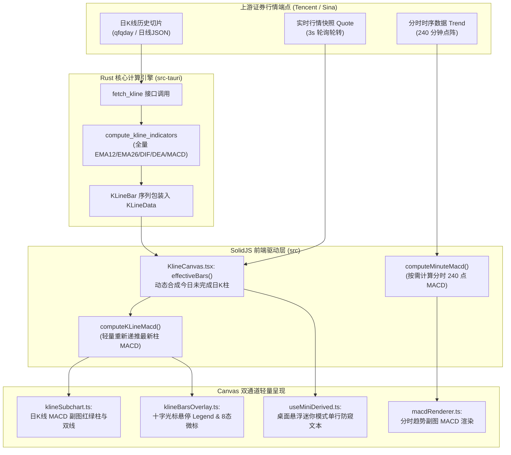

# 指数平滑异同移动平均线 (MACD 12, 26, 9) 需求与算法规范

> 模块分类：`kline`  
> 适用标的：`个股 | 板块 | 大盘全景`  
> 核心标签：`趋势动量 | 多空博弈 | 顶底背离 | 辅助决策`  
> 对应代码实现：[indicators.rs](file:///D:/Project/private/ai/ai-finance-moyu/src-tauri/src/quote/indicators.rs#L21-L48), [macdRenderer.ts](file:///D:/Project/private/ai/ai-finance-moyu/src/chart/renderers/macdRenderer.ts#L7-L161), [klineSubchart.ts](file:///D:/Project/private/ai/ai-finance-moyu/src/components/klineSubchart.ts#L58-L134), [indicators.ts](file:///D:/Project/private/ai/ai-finance-moyu/src/utils/indicators.ts#L50-L130)  
> 对应单元测试：[kline_tests.rs](file:///D:/Project/private/ai/ai-finance-moyu/src-tauri/src/quote/tests/kline_tests.rs#L76-L113), [indicators.test.ts](file:///D:/Project/private/ai/ai-finance-moyu/src/utils/indicators.test.ts#L62-L95)  

---

## 1. 业务定位与看盘指引

### 1.1 业务定义与核心意图
- **业务定义**：  
  指数平滑异同移动平均线（Moving Average Convergence Divergence，简称 **MACD**）由 Gerald Appel 提出，是金融工程与证券量化交易中应用最广泛的经典动量/趋势兼备型指标。MACD 利用快速指数平滑移动平均线（EMA 12）与慢速指数平滑移动平均线（EMA 26）之间的离差值（DIF），以及 DIF 的平滑平均线（DEA 9），结合动能柱状图（MACD Hist），系统性揭示价格运动的动量强度、趋势方向及潜在转折拐点。
- **看盘痛点与价值**：  
  在桌面常驻悬浮及极简摸鱼看盘场景下，屏幕空间极其受限，交易者无法展开全套重型看盘软件。普通简单均线（MA）存在严重的滞后性与震荡市假突破噪音，而传统指标在极小窗口中容易沦为“杂乱色块”。  
  本项目对 MACD 进行双层深度工程重构：
  1. **副图一键随心切**：副图支持在成交量柱（VOL）与 MACD 之间无缝切换；
  2. **8 状态智能机提炼**：将抽象的数值差离直接映射为清晰的看盘诊断语言（如“水上金叉”、“高位死叉”、“水下反弹”）；
  3. **超低视觉认知成本**：在迷你悬浮模式与微型状态栏中，仅凭单行高对比度浓缩摘要（如 `DIF 0.45 · MACD 0.12 水上金叉`），即可令交易者在 0.5 秒眼角余光扫视内准确感知个股动能拐点，实现关键风险规避与买卖点协同。

### 1.2 关键信号解读

#### 1.2.1 零轴多空界线体系 (Zero Axis Regimes)
MACD 以零轴（$0.0$ 水平线）为绝对的多空分水岭：
- **零轴上方（水上，$\text{DIF} \ge 0$）**：快速均线运行于慢速均线之上，表征中期市场处于多头占优的多头通道或多头主升浪。在此区间内的金叉多为主升浪二次发力；出现的回调多为良性蓄势。
- **零轴下方（水下，$\text{DIF} < 0$）**：快速均线运行于慢速均线之下，表征中期市场处于空头承压的下降通道。在此区间内的死叉极易导致恐慌杀跌；出现的金叉多属超跌反弹，需警惕反抽遇阻。

#### 1.2.2 8 状态精准诊断状态机 (8-State Diagnostic Taxonomy)
前端通过 `diagnoseMacd(dif, dea, prevDif, prevDea)` 函数将时序前后两组差离值严格映射为 8 种确定性诊断状态，兼顾日K线与日内分时：

| 诊断状态名称 | 核心判定逻辑 | 业务含义与交易指引 | 视觉配色 (Dark / Light) |
| :--- | :--- | :--- | :--- |
| **水上金叉** | $pDif \le pDea \land dif > dea \land dif \ge 0$ | 处于多头优势区发生金叉，主升浪加速或洗盘结束强力看多买点 | `UP` (`#ef4444` / `#dc2626`) |
| **低位金叉** | $pDif \le pDea \land dif > dea \land dif < 0$ | 处于弱势水下超跌企稳，技术性反弹初起，适合左侧博弈或防守减亏 | 警戒橙 (`#fb923c`) |
| **高位死叉** | $pDif \ge pDea \land dif < dea \land dif \ge 0$ | 处于高位动能衰竭下穿慢线，多头主力滞胀出货，获利了结与减仓警示 | 警示紫 (`#a855f7`) |
| **水下死叉** | $pDif \ge pDea \land dif < dea \land dif < 0$ | 处于空头区间再次死叉破位，杀跌加速或破底风险，严禁盲目抄底 | `DOWN` (`#22c55e` / `#16a34a`) |
| **水上多头** | $dif \ge dea \land dif \ge 0$ (维持多头) | 趋势平稳运行在零轴上方且快线压制慢线，安心持股持仓 | 绯红半透 (`rgba(239, 68, 68, 0.85)`) |
| **水下反弹** | $dif \ge dea \land dif < 0$ (超跌修复) | 弱势空头区内的超跌修复阶段，上方空间受零轴压制，以反抽对待 | 暖橙半透 (`rgba(251, 146, 60, 0.85)`) |
| **高位回调** | $dif < dea \land dif \ge 0$ (洗盘震荡) | 处于多头强势通道内的正常回踩，观察下探零轴是否获支撑止跌 | 淡紫半透 (`rgba(168, 85, 247, 0.85)`) |
| **水下空头** | $dif < dea \land dif < 0$ (主跌观望) | 典型中长期弱势下行波段，价格受制于下降均线，全面防守控仓 | 翠绿半透 (`rgba(34, 197, 94, 0.85)`) |

#### 1.2.3 顶底背离判据 (Divergence Analysis)
- **顶背离（Bearish Divergence）**：  
  当标的股价刷新前高（$P_{\text{high}, 2} > P_{\text{high}, 1}$），但对应的 $\text{DIF}$ 峰值或 $\text{MACD}$ 红柱峰值出现反向走低（$\text{DIF}_{\text{peak}, 2} < \text{DIF}_{\text{peak}, 1}$）。表明上涨缺乏增量资金支持，价升量背，属于典型的动能衰竭见顶信号，应果断止盈或防守。
- **底背离（Bullish Divergence）**：  
  当标的股价刷新前低（$P_{\text{low}, 2} < P_{\text{low}, 1}$），但对应的 $\text{DIF}$ 谷底或 $\text{MACD}$ 绿柱谷底反向抬高（$\text{DIF}_{\text{trough}, 2} > \text{DIF}_{\text{trough}, 1}$）。表明空头砸盘动能衰竭，恐慌盘已出清，属于高胜率的左侧超跌企稳信号。

#### 1.2.4 动能柱收敛与发散 (Histogram Dynamics)
- **红柱持续发散（高度放大）**：多头增量动能强劲，买方完全主导行情；
- **红柱持续收敛（高度缩短）**：多方推进受阻，动量开始减速，警惕多转空；
- **绿柱持续发散（绝对值放大）**：空头砸盘剧烈，流动性被动抽离；
- **绿柱持续收敛（绝对值缩短）**：空方下杀力竭，抛压显著减缓，酝酿企稳转势。

### 1.3 UI 呈现与防窥规范
- **宿主呈现组件**：
  1. `KlineCanvas.tsx` / `klineSubchart.ts`：日K线副图区域，支持 `subchartMode='macd'` 独立绘制；
  2. `trendChart.ts` / `macdRenderer.ts`：日内分时趋势副图区域；
  3. `klineBarsOverlay.ts`：日K十字光标悬停时的动态 Legend 读数与诊断文字；
  4. `useMiniDerived.ts`：极简悬浮迷你窗（Mini Mode）状态栏单行文本。
- **图表与视觉规范**：
  - **DIF 快线**：线宽 `1.1px`，全局绑定青蓝色（`COLOR_DIF = '#38bdf8'`）；
  - **DEA 慢线**：线宽 `1.1px`，全局绑定琥珀黄（`COLOR_DEA = '#f59e0b'`）；
  - **MACD 柱状图**：
    - 正值柱（$m \ge 0$）：填充色 `rgba(239, 68, 68, 0.88)`（暗色）或 `var(--up-color)`；
    - 负值柱（$m < 0$）：填充色 `rgba(34, 197, 94, 0.88)`（暗色）或 `var(--down-color)`；
    - 柱体宽度自适应：日K线为 `Math.max(1.5, Math.min(10, barW * 0.65))`；分时图为 `Math.max(1, (plotW / totalSlots) * 0.72)`；
  - **零轴基线（Zero-Axis Baseline）**：
    - 1px 高精度对齐基线，通过 `Math.round(yOfMacd(0)) + 0.5` 保证像素锐利无重影；
    - 虚线样式：`ctx.setLineDash([2, 2])`；
    - 暗色系描边为 `rgba(255, 255, 255, 0.16)`；浅色系通过全局 Canvas 主题自动适配为 `rgba(0, 0, 0, 0.16)`。
  - **副图纵轴缩放与 15% 边距保护**：
    - 遍历可视区域内所有 `dif`、`dea`、`macd`，计算绝对极值区间 $[minM, maxM]$；
    - 增加 15% 动态头部与底部留白：`spanM = Math.max(0.0001, (maxM - minM) * 1.15)`；
    - 平水状态兜底：若序列全部为 0，保底区间限制为 `[-0.05, 0.05]`（日K）或 `[-0.02, 0.02]`（分时），杜绝除零崩溃。
- **全主题自适应（严格遵循 AGENTS.md §15）**：
  - **深邃暗黑（Dark / Ocean / Cyberpunk）**：文字与曲线对比度充足，红柱 `#ef4444`，绿柱 `#22c55e`；
  - **办公浅色（Light）**：涨跌指标必须绑定深饱满红绿，正红采用 `#dc2626`，深翡翠绿采用 `#16a34a`，文本采用 `rgba(0, 0, 0, 0.65)`，杜绝浅荧光绿发飘及白底孤岛色。
- **极简防窥要求**：
  - 在迷你悬浮窗（Mini Mode）及把手折叠态下，不渲染冗余的副图坐标轴刻度线与重度文字，仅在底部信息行紧凑输出 `DIF 0.45 · MACD 0.12 水上金叉`；
  - 鼠标离开悬浮窗后，把手维持 6~11px 超薄防窥状态，避免敏感金融图表被旁人窥视。

---

## 2. 数学公式与算法细节

### 2.1 依赖基础数据
- **日K线模式**：
  - 输入：`bars: Vec<KLineBar>` 数组中的收盘价 `bar.close: f64`；
  - 粒度：日线级别（每个 Bar 代表一个自然交易日）。
- **日内分时模式**：
  - 输入：`points: Vec<TrendPoint>` 数组中的分钟加权/收盘价 `point.price: f64`；
  - 粒度：1 分钟粒度（A 股交易日标准 240 点，全景图包含集合竞价点位）。

### 2.2 核心数学公式与递推逻辑

#### 2.2.1 标准参数体系
系统默认采用 Appel 经典标准参数三元组：
$$\text{MACD}(\text{fast}, \text{slow}, \text{signal}) = (12, 26, 9)$$

配置中心额外支持两套衍生预设与个性化定制：
- **极速超短**：$(6, 13, 5)$，用于捕捉高频拐点；
- **经典短线**：$(12, 26, 9)$（默认推荐）；
- **中线波段**：$(19, 39, 9)$，用于过滤中型震荡。

#### 2.2.2 指数移动平均平滑系数 ($\alpha$)
对于任意周期 $N$，其指数平滑衰减系数为：
$$\alpha_N = \frac{2}{N + 1}$$
具体计算值如下：
- 快速系数：$\alpha_{12} = \frac{2}{12 + 1} = \frac{2}{13} \approx 0.153846$，历史权重占比 $1 - \alpha_{12} = \frac{11}{13} \approx 0.846154$；
- 慢速系数：$\alpha_{26} = \frac{2}{26 + 1} = \frac{2}{27} \approx 0.074074$，历史权重占比 $1 - \alpha_{26} = \frac{25}{27} \approx 0.925926$；
- 信号平滑系数：$\alpha_{9} = \frac{2}{9 + 1} = \frac{2}{10} = 0.200000$，历史权重占比 $1 - \alpha_{9} = \frac{8}{10} = 0.800000$。

#### 2.2.3 递归迭代递推方程
对于时序序列索引 $i \ge 1$（$c_i$ 表示第 $i$ 期收盘价格）：
1. **快速指数移动平均（EMA 12）**：
   $$\text{EMA}_{12}[i] = \text{EMA}_{12}[i-1] \times \frac{11}{13} + c_i \times \frac{2}{13}$$
2. **慢速指数移动平均（EMA 26）**：
   $$\text{EMA}_{26}[i] = \text{EMA}_{26}[i-1] \times \frac{25}{27} + c_i \times \frac{2}{27}$$
3. **离差值快线（DIF）**：
   $$\text{DIF}[i] = \text{EMA}_{12}[i] - \text{EMA}_{26}[i]$$
4. **讯号平滑慢线（DEA 9 / Signal Line）**：
   $$\text{DEA}[i] = \text{DEA}[i-1] \times \frac{8}{10} + \text{DIF}[i] \times \frac{2}{10}$$
5. **动能柱状图（MACD Histogram）**：
   $$\text{MACD\_HIST}[i] = (\text{DIF}[i] - \text{DEA}[i]) \times 2.0$$
   *(注：严格遵循中国 A 股及主流证券软件行业惯例，将差离值乘以 2 放大柱体视觉动态。)*

#### 2.2.4 数值舍入与精度契约
- **计算过程存储**：内部状态变量（`ema12`, `ema26`, `dea`）全程采用 IEEE 754 标准双精度浮点数（`f64` / `number`）进行高精度累积迭代，严禁中途截断；
- **输出精度截断**：最终持久化与传输对象保留 **3 位小数**（四舍五入规则）：
  - Rust 后端：`bar.dif = Some((dif * 1000.0).round() / 1000.0);`
  - 前端 TS：`Math.round(dif * 1000) / 1000`；
- **UI 呈现格式化**：界面绘制时保留 **2 位小数**（`.toFixed(2)`）。

### 2.3 边界情况与冷启动处理

#### 2.3.1 序列初始值冷启动（$i = 0$）
金融学关于 MACD 初始值存在数种流派，本项目采用行业最为通用的“首根收盘价对齐并置零”法，实现冷启动零偏置：
$$\text{EMA}_{12}[0] = c_0, \quad \text{EMA}_{26}[0] = c_0$$
$$\text{DIF}[0] = \text{EMA}_{12}[0] - \text{EMA}_{26}[0] = 0.0$$
$$\text{DEA}[0] = 0.0$$
$$\text{MACD}[0] = (\text{DIF}[0] - \text{DEA}[0]) \times 2.0 = 0.0$$
该初始值策略使得首根 Bar 的 DIF、DEA、MACD 均为平滑的 $0.0$，绝不出现 `NaN` 或破损断崖。

#### 2.3.2 空序列与异常防御
- **空输入保护**：
  - Rust 后端：若 `bars.is_empty()`，安全返回空 `bars`，不触发内存解引用；
  - 前端 TS：`if (bars.length === 0) return;`，直接短路返回。
- **除零与极窄区间保护**：
  在计算副图坐标映射 `yOfMacd(v)` 时，当价格完全横盘（如连续一字跌停无振幅），$maxM - minM = 0$。算法强制引入保底 Span：
  ```ts
  if (minM === 0 && maxM === 0) {
    minM = -0.05
    maxM = 0.05
  }
  const spanM = Math.max(0.0001, (maxM - minM) * 1.15)
  ```
  彻底杜绝 Canvas 坐标计算产生 `Infinity` 或导致浏览器 GPU 线程渲染冻结。

---

## 3. 数据契约与时段规则

### 3.1 上游数据链路



- **前后端算力分工（严格遵循 AGENTS.md §4 & §11）**：
  1. **Rust 后端承载全量时序计算**：单只标的历史上百根日 K 线的数据拉取后，一次性在后端执行 `compute_kline_indicators`，以原生并发性能完成递推运算，直接填充进 `KLineBar` 字段（`dif`, `dea`, `macd`）；
  2. **前端轻量承载盘中增量合成与分时运算**：
     - **日K线盘中实时柱**：盘中交易时段，前端收到最新 `Quote` 后，在 `effectiveBars()` 中将今日实时价格合成为最后一根临时 Bar，并就地调用纯函数 `computeKLineMacd(list, props.macdParams)` 更新最新柱的 MACD 值，保证图表实时跃动；
     - **分时 MACD 序列**：分时图仅在用户显式切换至 MACD 模式或默认开启时，由 `computeMinuteMacd(points, opts.macdParams)` 纯函数按需计算，避免无意义的后台空转。
- **参数解析与继承链路**：
  通过 `resolveIndicatorParams(item, global)` 解析有效参数：
  $$\text{item.customMacd} \longrightarrow \text{item.indicatorMode} \longrightarrow \text{global.indicatorConfig.macd} \longrightarrow [12, 26, 9]$$

### 3.2 A 股交易时段门禁
- **早盘集合竞价（09:15 - 09:25）**：
  - 此阶段撮合价格包含诱多/诱空撤单，分时 MACD 保持前一收盘静默或展示离线快照；
  - 严禁在此阶段向操作系统发送系统级桌面弹窗通知，异动仅通过卡片微标呈现（遵循 AGENTS.md §3）；
- **盘前静默期（09:25 - 09:30）**：
  - 开盘价已确定，系统合成当日第一根日K柱并计算初始动态 MACD，分时图锁定等待 09:30 开盘；
- **连续竞价时段（09:30 - 11:30, 13:00 - 14:57）**：
  - 按照 3 秒轮询节奏接收实时行情，动态更新当前最新日K柱及分时时序点阵，实时刷新 8 态诊断与红绿柱收敛状态；
- **尾盘集合竞价与收盘（14:57 - 15:00）**：
  - 锁定当日最终收盘价，确定当日日K线最终 MACD 结转数据并入库缓存；
- **非交易时段与离线容灾**：
  - 交易时段外停止高频轮询，静默展示收盘快照；若遇网络中断或接口 429 限流，系统自动回退至本地基准缓存（Baseline Fallback Cache），保证界面平滑无白屏。

---

## 4. 告警阈值与防扰规范

### 4.1 触发判定规则
- **金叉突破告警**：
  - 触发条件：$pDif \le pDea$ 且 $dif > dea$；
  - 水上金叉归类为强买点异动，低位金叉归类为反弹博弈异动。
- **死叉破位告警**：
  - 触发条件：$pDif \ge pDea$ 且 $dif < dea$；
  - 高位死叉归类为例行止盈预警，水下死叉归类为高危防守破位预警。
- **动能衰竭变色反转预警**：
  - 红柱连续 3 根收缩后首次转绿（多翻空临界点）；
  - 绿柱连续 3 根收缩后首次转红（空翻多拐点）。

### 4.2 节流防轰炸与静音机制
- **频次节流（Cooldown Window）**：
  - 单个标的同一种 MACD 告警信号（如水上金叉）在 **5 分钟** 冷却窗口内仅触发一次告警通知，避免在临界点震荡时反复弹窗轰炸。
- **免打扰守则（Do-Not-Disturb）**：
  - 集合竞价阶段（09:15-09:25）与午间休市（11:30-13:00）一律禁止弹出桌面系统级 Toast 通知；
  - 极简防窥状态下，优先使用状态指示微标或紧凑文字提示，禁止侵入式打断用户办公。
- **分级日志留痕规范（遵循 AGENTS.md §7）**：
  - 严禁在每秒数十次的 Canvas 渲染或高频轮询中调用未经节流的 `console.log` 或 `println!`；
  - 关键跨越事件统一通过标准日志 Facade 输出并持久化：
    ```rust
    log::info!(target: "ALERT", "[MACD] {} 触发关键信号: {}", code, diag_text);
    ```
  - 用户配置变更记入 `USER` Target，网络断网降级记入 `NET` Target。

---

## 5. 验收基准与测试对齐

### 5.1 黄金测试用例 (Golden Fixture)
输入标准收盘价时序序列（包含冷启动、持续上涨、见顶滞胀、高位回踩及高位死叉全部典型阶段）：
```json
[10.00, 10.50, 11.20, 10.80, 11.50, 12.00, 11.80, 12.50, 13.00, 12.20, 11.00, 9.80, 8.50]
```

参数采用经典设定：$\text{fast}=12, \text{slow}=26, \text{signal}=9$。  
确定性黄金计算结果矩阵如下表所示：

| 索引 $i$ | 收盘价 | $\text{EMA}_{12}$ | $\text{EMA}_{26}$ | $\text{DIF}$ (保留3位) | $\text{DEA}$ (保留3位) | $\text{MACD}$ 柱 | 8态诊断状态 | 信号类型归类 |
| :---: | :---: | :---: | :---: | :---: | :---: | :---: | :---: | :---: |
| **0** | 10.00 | 10.0000 | 10.0000 | **0.000** | **0.000** | **0.000** | 水上多头 | 序列冷启动初始化 |
| **1** | 10.50 | 10.0769 | 10.0370 | **0.040** | **0.008** | **0.064** | **水上金叉** | 首次多头突破启动 |
| **2** | 11.20 | 10.2497 | 10.1232 | **0.127** | **0.032** | **0.190** | 水上多头 | 主升浪红柱发散 |
| **3** | 10.80 | 10.3344 | 10.1733 | **0.161** | **0.058** | **0.207** | 水上多头 | 强势洗盘震荡 |
| **4** | 11.50 | 10.5137 | 10.2716 | **0.242** | **0.094** | **0.295** | 水上多头 | 再次放量上攻 |
| **5** | 12.00 | 10.7424 | 10.3996 | **0.343** | **0.144** | **0.397** | 水上多头 | 加速推升 |
| **6** | 11.80 | 10.9051 | 10.5034 | **0.402** | **0.196** | **0.412** | 水上多头 | 动能峰值停顿 |
| **7** | 12.50 | 11.1504 | 10.6513 | **0.499** | **0.256** | **0.486** | 水上多头 | 创出新高 |
| **8** | 13.00 | 11.4350 | 10.8252 | **0.610** | **0.327** | **0.565** | 水上多头 | 极值峰值，多头极盛 |
| **9** | 12.20 | 11.5527 | 10.9271 | **0.626** | **0.387** | **0.478** | 水上多头 | 柱体收缩，动能衰竭 |
| **10** | 11.00 | 11.4677 | 10.9325 | **0.535** | **0.416** | **0.237** | 水上多头 | 快速杀跌，红柱濒临归零 |
| **11** | 9.80 | 11.2111 | 10.8486 | **0.363** | **0.406** | **-0.086** | **高位死叉** | 快线下穿慢线，减仓离场 |
| **12** | 8.50 | 10.7940 | 10.6746 | **0.119** | **0.348** | **-0.458** | **高位回调** | 绿柱发散，空方主导调整 |

### 5.2 代码与测试映射 (Traceability Matrix)

| 架构层级 | 业务功能模块 | 具体实现文件及代码行号 |
| :--- | :--- | :--- |
| **后端 Rust** | K线全量指标综合计算引擎 | [indicators.rs (L21-L48)](file:///D:/Project/private/ai/ai-finance-moyu/src-tauri/src/quote/indicators.rs#L21-L48) |
| **后端 Rust** | KLineBar / KLineData 结构定义 | [types.rs (L164-L207)](file:///D:/Project/private/ai/ai-finance-moyu/src-tauri/src/quote/types.rs#L164-L207) |
| **后端 Rust** | 指标参数配置与缺省值 | [prefs.rs (L30-L50)](file:///D:/Project/private/ai/ai-finance-moyu/src-tauri/src/config/prefs.rs#L30-L50) |
| **后端 Rust** | 后端 K线指标自动化单元测试 | [kline_tests.rs (L76-L113)](file:///D:/Project/private/ai/ai-finance-moyu/src-tauri/src/quote/tests/kline_tests.rs#L76-L113) |
| **前端 SolidJS** | 8 状态 MACD 诊断状态机 | [macdRenderer.ts (L7-L39)](file:///D:/Project/private/ai/ai-finance-moyu/src/chart/renderers/macdRenderer.ts#L7-L39) |
| **前端 SolidJS** | 分时/通用 MACD Canvas 渲染器 | [macdRenderer.ts (L54-L161)](file:///D:/Project/private/ai/ai-finance-moyu/src/chart/renderers/macdRenderer.ts#L54-L161) |
| **前端 SolidJS** | 日K线纯 MACD 副图 Canvas 渲染器 | [klineSubchart.ts (L58-L134)](file:///D:/Project/private/ai/ai-finance-moyu/src/components/klineSubchart.ts#L58-L134) |
| **前端 SolidJS** | 十字光标 Legend 与诊断微标 | [klineBarsOverlay.ts (L171-L203)](file:///D:/Project/private/ai/ai-finance-moyu/src/components/klineBarsOverlay.ts#L171-L203) |
| **前端 SolidJS** | 盘中动态 Bar 增量合成与 MACD 重算 | [KlineCanvas.tsx (L72-L106)](file:///D:/Project/private/ai/ai-finance-moyu/src/components/KlineCanvas.tsx#L72-L106) |
| **前端 SolidJS** | 分时趋势图副图 MACD 挂载点 | [trendChart.ts (L106-L163)](file:///D:/Project/private/ai/ai-finance-moyu/src/chart/renderers/trendChart.ts#L106-L163) |
| **前端 SolidJS** | 日K线序列纯函数重算 `computeKLineMacd` | [indicators.ts (L50-L86)](file:///D:/Project/private/ai/ai-finance-moyu/src/utils/indicators.ts#L50-L86) |
| **前端 SolidJS** | 分时点阵纯函数重算 `computeMinuteMacd` | [indicators.ts (L92-L130)](file:///D:/Project/private/ai/ai-finance-moyu/src/utils/indicators.ts#L92-L130) |
| **前端 SolidJS** | 指标参数继承与动态解析 | [indicators.ts (L199-L229)](file:///D:/Project/private/ai/ai-finance-moyu/src/utils/indicators.ts#L199-L229) |
| **前端 SolidJS** | 迷你模式极简防窥文本格式化 | [useMiniDerived.ts (L64-L108)](file:///D:/Project/private/ai/ai-finance-moyu/src/layouts/useMiniDerived.ts#L64-L108) |
| **前端测试** | 前端 MACD 纯函数自动化单元测试 | [indicators.test.ts (L62-L95)](file:///D:/Project/private/ai/ai-finance-moyu/src/utils/indicators.test.ts#L62-L95) |
