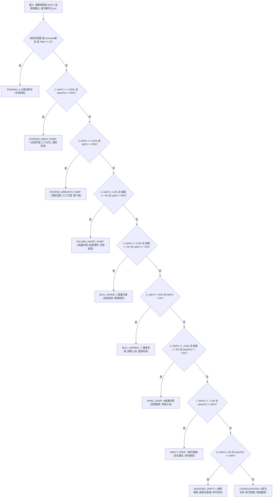

# 市场涨跌平分布与赚钱效应 (Market Breadth) 需求与算法规范

> 模块分类：`market`  
> 适用标的：`大盘全景`  
> 核心标签：`宏观全景`  
> 对应代码实现：
> - 后端数据拉取与熔断：[breadth.rs](file:///D:/Project/private/ai/ai-finance-moyu/src-tauri/src/market_overview/breadth.rs#L1-L166)
> - 后端大盘全景装配与基准缓存：[fetcher.rs](file:///D:/Project/private/ai/ai-finance-moyu/src-tauri/src/market_overview/fetcher.rs#L1-L252)
> - 后端凭据解析层：[wencai.rs](file:///D:/Project/private/ai/ai-finance-moyu/src-tauri/src/market_overview/wencai.rs#L1-L68)
> - 前端穿透诊断引擎：[indexDiagnosis.ts](file:///D:/Project/private/ai/ai-finance-moyu/src/utils/indexDiagnosis.ts#L1-L245)
> - 前端胶囊徽标与浮窗呈现：[IndexBadge.tsx](file:///D:/Project/private/ai/ai-finance-moyu/src/components/IndexBadge.tsx#L1-L145)
> - 前端大盘全景多空温度计：[Market.tsx](file:///D:/Project/private/ai/ai-finance-moyu/src/layouts/Market.tsx#L35-L145)  
> 对应单元测试：
> - 后端配额熔断测试：[market_overview/mod.rs](file:///D:/Project/private/ai/ai-finance-moyu/src-tauri/src/market_overview/mod.rs#L135-L150)
> - 后端凭据三级降级测试：[market_overview/wencai.rs](file:///D:/Project/private/ai/ai-finance-moyu/src-tauri/src/market_overview/wencai.rs#L28-L68)
> - 前端九维诊断黄金用例：[indexDiagnosis.test.ts](file:///D:/Project/private/ai/ai-finance-moyu/src/utils/indexDiagnosis.test.ts#L1-L203)

---

## 1. 业务定位与看盘指引

### 1.1 业务定义与核心意图
- **定义**：市场广度与涨跌平分布（Market Breadth）是全景反映 A 股全市场（沪深京全 A 股超 5300 只股票）整体多空博弈力量对比与赚钱效应的核心宏观量化指标。它统计全市场处于上涨、下跌、平盘状态的股票绝对数量，计算上涨/下跌占比，并结合指数变动与两市成交额环比增减，穿透大盘指数表象，输出全市场的真实情绪水温。
- **看盘痛点与价值**：
  1. **破除“指数失真”与“赚指数不赚钱”困境**：A 股市场加权指数（如上证指数、沪深300）受贵州茅台、工商银行、宁德时代等大市值权重股影响极大。主力资金经常利用大票护盘或拉抬指标股，使指数维持红盘，但底层 70%~80% 的中小创个股大幅下挫（即典型的“二八分化”、“拉权掩护出货”）。
  2. **捕捉“八二行情”题材赚钱效应**：在指数受权重拖累微跌或横盘震荡时，若全市场超 65% 个股红盘普涨，说明中小市值题材活跃，存在极佳的做多赚钱窗口。
  3. **摸鱼桌面极低认知负荷**：在办公室微型悬浮挂件或贴边折叠形态下，交易者无法展开重型行情软件。本指标通过极简的胶囊微标（如 `🚨拉权护盘 (31%涨)`、`🔥放量共振 (82%涨)`）与红绿多空温度计，让用户在 1 秒内获知市场真实生态，决定是积极进场还是防守控仓。

### 1.2 关键信号解读
基于全市场涨跌比、指数涨跌幅、两市成交额环比变动三重交叉印证，系统将市场状态精准归纳为以下核心信号与操盘指引：

| 诊断状态代码 (`DiagnosisCode`) | 胶囊外露标签 (`badgeLabel`) | 紧凑标签 (`compactLabel`) | 色调 (`tone`) | 实战操作指引 (`guidance`) | 盘面特征与实况解读 |
| :--- | :--- | :--- | :--- | :--- | :--- |
| **`DIVERGE_INDEX_PUMP`** | `🚨拉权护盘 (31%涨)` | `拉大票` | `warn` (警戒黄) | `【谨防诱多】` | **二八分化严重**。大盘指数平盘或微涨（\(\ge -0.05\%\)），但全市场超 60% 个股下跌，大市值权重掩护中小创题材失血，赚指数不赚钱，切忌盲目追高。 |
| **`DIVERGE_BREADTH_PUMP`** | `💎题材活跃 (68%涨)` | `做个股` | `bull` (多头红) | `【轻指数重个股】` | **八二题材火爆**。大盘指数滞涨或微跌（\(\le 0.15\%\)），但全市场超 65% 个股上涨，底层题材百花齐放，真实赚钱效应强劲，顺应主线精选个股。 |
| **`VOLUME_SHORT_PUMP`** | `⚠️缩量冲高 (58%涨)` | `缩量拉` | `warn` (警戒黄) | `【切忌追高】` | **缩量反弹背离**。指数涨幅显著（\(>0.3\%\)）但两市成交额较昨日缩量超 5%，且上涨比例不足 65%，存量博弈缺乏买盘增量支撑，谨防冲高回落。 |
| **`BULL_SURGE`** | `🔥放量共振 (79%涨)` | `共振普涨` | `bull` (多头红) | `【顺势看多】` | **全面牛市/普涨爆发**。两市成交额较昨日放量超 5%，指数涨超 0.5%，且上涨家数超 75%，真金白银共振推动，多头动能极其充沛。 |
| **`BULL_NORMAL`** | `📈偏多走强 (63%涨)` | `偏多走强` | `bull` (多头红) | `【逢低布局】` | **温和良性走强**。多头占据盘面优势，上涨比例达 60% 以上且指数收红，买盘有序推升，具备良好赚钱效应。 |
| **`PANIC_DUMP`** | `❄️放量恐慌 (81%跌)` | `恐慌砸盘` | `bear` (空头绿) | `【多看少动】` | **放量恐慌杀跌**。指数大跌 \(\le -0.8\%\) 且伴随放量，个股下跌比例超 75%，非理性恐慌盘与融资止损盘涌出，切莫盲目抄底接飞刀。 |
| **`HEAVY_DROP`** | `⚡破位重挫 (72%跌)` | `重挫破位` | `bear` (空头绿) | `【防守避险】` | **破位深跌**。指数跌幅超 1.0% 且超 65% 个股下跌，空头抛压沉重，均线破位，必须严格控制仓位规避风险。 |
| **`BLEEDING_DRIFT`** | `📉弱势阴跌 (64%跌)` | `弱势阴跌` | `bear` (空头绿) | `【防守控仓】` | **弱势阴跌无承接**。指数绿盘下跌且超 60% 个股走弱，市场缺乏增量资金，交投清淡，多头无力组织反抗，以防守防御为主。 |
| **`CONSOLIDATION`** | `⚖️多空对峙 (51%涨)` | `窄幅震荡` | `neutral` (中性灰) | `【观望蓄势】` | **多空拉锯电风扇**。涨跌家数基本持平（各占 40%~60%），板块轮动杂乱无章，观望等待趋势选择。 |
| **`PENDING`** | `● 大盘诊断中` | `诊断中` | `neutral` (中性灰) | `【等待行情】` | **未加载或休市中**。数据冷启动、盘前初始化或非指数标的，优雅兜底，杜绝异常与报错。 |

### 1.3 UI 呈现与防窥规范
指标在不同前端视图层级中遵循分层设计与防窥规范：

1. **Mini Header 与列表紧凑微标 (`IndexBadge.tsx`)**：
   - **外露形态**：在 Mini 顶栏或自选股列表中紧随指数名称渲染。紧凑模式仅显示 3~4 字（如 `拉大票`、`做个股`、`共振普涨`），字号收紧至 `9px`，内边距 `0 4.5px`，防窥隐蔽；非紧凑模式显示带 emoji 与百分比的胶囊微标（如 `🚨拉权护盘 (31%涨)`）。
   - **双列网格悬浮卡片 (`.index-popover`)**：
     - **头部与实况**：展示定性大标签、操盘指引徽标与一句话大白话实况；
     - **红绿多空条 (`.index-breadth-row`)**：展示「涨 1200 (23%) · 跌 3800 (75%) · 平 100」，中间为 `4px` 高度的微型双色横条（红涨绿跌），直观显示多空比例；
     - **两列结构卡片 (`.index-card-grid`)**：左列「📊 资金量能」（两市成交总额、较昨日放量/缩量幅度），右列「🧭 市场特征」（主线风格如“科技进攻/权重维稳”、分时形态）；
     - **三大指数底栏**：单行并排显示上证指数、深证成指、创业板指实时涨跌幅。
2. **大盘全景看板 (`Market.tsx` 市场温度看板)**：
   - 顶部提供「全市场多空温度计」：卡片式罗列涨、平、跌三组大字徽标，下方搭配全宽度的比例红绿能量条（`breadth-bar-container`）；
   - 展示两市成交总额与较昨日环比百分比及金额（例如 `较昨日 缩量 1200亿 (-8.5%)`）。
3. **全局状态栏 Tooltip (`Bar.tsx`)**：
   - 在底部/边缘工具条鼠标悬停于指数时，Tooltip 格式化注入：`两市成交: 1.85万亿 (较昨日放量 1200亿 (+6.5%)) | 涨 3450 跌 1680`。
4. **全主题自适应与红绿高对比度红线（严格遵守 AGENTS.md §15）**：
   - **暗黑主题 (`dark`)**：
     - 上涨/多头：背景 `var(--color-up-bg)`（半透明暗红），文字 `var(--color-up-subtle)`（亮粉红 `#fca5a5`），边框 `var(--color-up-border)`；
     - 下跌/空头：背景 `var(--color-down-bg)`（半透明暗绿），文字 `var(--color-down-subtle)`（翠绿 `#86efac`）；
     - 警示/背离：背景 `var(--color-warning-bg)`，文字 `#fcd34d`。
   - **办公浅色主题 (`light`)**：
     - **红绿高对比度保障**：严格采用正红 `--color-up: #dc2626`、深翡翠绿 `--color-down: #16a34a`，严禁在纯白背景使用刺眼发飘的浅荧光绿；
     - 容器与卡片使用 `--surface-glass-bg: #ffffff`、`--surface-border-subtle: rgba(0, 0, 0, 0.08)`，文字为高可读性石板灰 `--text-primary: #0f172a`。
   - **严禁静态孤岛色**：所有组件严格绑定 CSS 语义化变量（如 `var(--text-color)`、`var(--card-bg)`、`var(--surface-popover-bg)`），杜绝任何硬编码颜色。

---

## 2. 数学公式与算法细节

### 2.1 依赖基础数据
市场广度指标依赖后端聚合提供的快照元组 `BreadthSnapshot` 与指数行情：

| 数据字段 | 类型 | 含义与单位 | 来源 |
| :--- | :--- | :--- | :--- |
| `up_count` | `u32` / `number` | 全 A 股实时上涨股票总家数 (家) | 同花顺问财 OpenAPI / 基准缓存 |
| `down_count` | `u32` / `number` | 全 A 股实时下跌股票总家数 (家) | 同花顺问财 OpenAPI / 基准缓存 |
| `flat_count` | `u32` / `number` | 全 A 股实时平盘股票总家数 (家) | 同花顺问财 OpenAPI / 基准缓存 |
| `turnover_change_pct` | `Option<f64>` | 两市总成交额较前一日同期的环比增长率 (%) | 同花顺问财 OpenAPI / 计算推导 |
| `turnover_change_amount`| `Option<f64>` | 两市总成交额较前一日同期的增减绝对金额 (元) | 后端数学反推公式求得 |
| `quote.changePct` | `f64` / `number` | 指数（如上证指数 `sh000001`）实时涨跌幅 (%) | 腾讯财经实时行情接口 (`qt.gtimg.cn`) |
| `total_turnover` | `f64` / `number` | 沪深两市指数成交额汇总（元） | 腾讯行情 `s_sh000001` + `s_sz399001` |

### 2.2 核心数学公式与递推逻辑

#### 1. 市场涨跌比例计算
有效股票总样本数：
$$Total = \max(1, up\_count + down\_count + flat\_count)$$

上涨占比与下跌占比（四舍五入保留整数百分比，用于徽标与红绿能量条）：
$$up\_pct = \text{round}\left(\frac{up\_count}{Total} \times 100\right)$$
$$down\_pct = \text{round}\left(\frac{down\_count}{Total} \times 100\right)$$

#### 2. 成交额环比增减绝对金额反推公式
问财接口直接返回当日实时成交额 $Turnover_{today}$ 及环比增长率 $pct = turnover\_change\_pct$（单位 %）。  
昨日同期成交额 $Turnover_{yesterday}$ 为：
$$Turnover_{yesterday} = \frac{Turnover_{today}}{1 + \frac{pct}{100}} = Turnover_{today} \times \frac{100}{100 + pct}$$

因此，成交额增减金额 $\Delta Turnover$ 为：
$$\Delta Turnover = Turnover_{today} - Turnover_{yesterday} = Turnover_{today} \times \left(1 - \frac{100}{100 + pct}\right) = Turnover_{today} \times \left(\frac{pct}{100 + pct}\right)$$

后端实现代码（见 [breadth.rs#L144-L153](file:///D:/Project/private/ai/ai-finance-moyu/src-tauri/src/market_overview/breadth.rs#L144-L153)）：
```rust
let turnover_change_amount = match (turnover_val, turnover_change_pct) {
    (Some(turnover), Some(pct)) => {
        if (100.0 + pct).abs() > 1e-4 {
            Some(turnover * (pct / (100.0 + pct)))
        } else {
            None
        }
    }
    _ => None,
};
```

#### 3. 九维量化诊断状态机决策矩阵
诊断引擎 `diagnoseIndex` 按照优先级自上而下匹配规则（第一条命中的分支生效）：



#### 4. 赚钱效应量化分级
根据上涨比例 $up\_pct$，全市场赚钱效应划分为五个阶梯：
- **极佳（亢奋高潮）**：$up\_pct \ge 75\%$（上涨超 4000 家），赚钱效应爆棚，短线情绪高涨；
- **良性（偏多顺风）**：$60\% \le up\_pct < 75\%$（上涨 3200~4000 家），多数个股盈利，主线明确；
- **中性（分歧震荡）**：$40\% \le up\_pct < 60\%$（上涨 2100~3200 家），多空势均力敌，题材轮动快速；
- **亏钱（分化偏空）**：$25\% \le up\_pct < 40\%$（上涨 1300~2100 家），多数个股调整，追高极易被套；
- **极差（冰点恐慌）**：$up\_pct < 25\%$（上涨不足 1300 家，如下跌超 4000 家），市场处于极度亏钱效应或恐慌出清阶段。

### 2.3 边界情况与冷启动处理
1. **冷启动本地平滑基准缓存 (Baseline Fallback Cache)**：
   - 当用户首次启动应用、网络尚未就绪、未配置 API Key 或远端接口配额耗尽熔断时，Rust 后端必须立即可靠提供默认基准数据，**严禁出现崩塌、卡死或界面全 0**（遵循 AGENTS.md §2 与 §14）。
   - **标准基准值**（定义于 [fetcher.rs#L27-L33](file:///D:/Project/private/ai/ai-finance-moyu/src-tauri/src/market_overview/fetcher.rs#L27-L33)）：
     $$\begin{aligned}
     up\_count &= 1167 \\
     down\_count &= 4324 \\
     flat\_count &= 69 \\
     turnover\_change\_pct &= -19.09\% \\
     turnover\_change\_amount &= -3658.9 \text{ 亿元 } (-365,890,000,000.0 \text{ 元})
     \end{aligned}$$
2. **全 0 与脏数据防御**：
   - 问财接口偶发返回 `up_count == 0 && down_count == 0`，后端判定为无效数据，自动丢弃并平滑保留现有 `cached_breadth`（见 [breadth.rs#L139-L142](file:///D:/Project/private/ai/ai-finance-moyu/src-tauri/src/market_overview/breadth.rs#L139-L142)）。
   - 前端接收到 $Total \le 10$ 时，直接判定为数据未就绪，安全回退为 `PENDING` 状态，避免除以 0 导致 `NaN%`。
3. **极值除零保护**：
   - 在成交额环比增减反推公式中，若 $100.0 + pct \approx 0$（即两市成交额暴跌 100%），执行 `(100.0 + pct).abs() > 1e-4` 校验，若不满足则安全置为 `None`，杜绝浮点数除零崩溃。
4. **反爬 HTML 页面过滤**：
   - 若网关返回 `200 OK` 但内容以 `<`（HTML 报错页面或 WAF 盾）开头，直接抛出 `问财接口返回非 JSON 页面` 并安全回退基准缓存（见 [breadth.rs#L99-L101](file:///D:/Project/private/ai/ai-finance-moyu/src-tauri/src/market_overview/breadth.rs#L99-L101)）。

---

## 3. 数据契约与时段规则

### 3.1 上游数据链路
1. **网络通道与协议**：
   - **端点**：`POST https://openapi.iwencai.com/v1/query2data`
   - **认证头**：`Authorization: Bearer <API_KEY>`
   - **问财专有协议头**：
     ```http
     Content-Type: application/json
     X-Claw-Call-Type: normal
     X-Claw-Skill-Id: hithink-zhishu-query
     X-Claw-Skill-Version: 1.0.0
     X-Claw-Plugin-Id: none
     X-Claw-Plugin-Version: none
     X-Claw-Trace-Id: <64-hex-timestamp-hash>
     ```
   - **自然语言查询 Payload**：
     ```json
     {
       "query": "同花顺全A 上涨家数 下跌家数 平家数 成交额 成交额环比增长率",
       "page": "1",
       "limit": "10",
       "is_cache": "1",
       "expand_index": "true"
     }
     ```
2. **计算职责收口**：
   - 遵循 AGENTS.md §4 与 §11 准则：网络请求、Token 注入、GB18030 字符解析、JSON 穿透抽取、除零防御及金额反推计算**一律收口于 Rust 后端 (`breadth.rs`, `fetcher.rs`)**；
   - 前端 SolidJS 仅作为轻量渲染层，通过 Tauri Command 获取强类型 `MarketOverview`，本地完成轻量级状态机判断（耗时 < 1ms）。
3. **三级降级链路 (Fallback Cascade，遵循 AGENTS.md §2)**：
   ```mermaid
   flowchart LR
       Step1["1. 用户前端设置面板保存的 Key (iwencai_api_key)"] -->|未配置或为空| Step2["2. 环境变量 (FUYAO_API_KEY / HITHINK_FINANCE_API_KEY / IWENCAI_API_KEY)"]
       Step2 -->|未找到环境变量| Step3["3. 内存与本地基准缓存 (Baseline Fallback Cache)"]
   ```
   - **免配置开箱即用**：新用户克隆代码未配置 Key 时，应用绝不报错崩溃，自动无感启用基准缓存，大盘看板完整呈现。

### 3.2 A 股交易时段门禁与 180s 节流
1. **180s 极轻轮询节流 (180s Query Throttle)**：
   - 市场全景广度数据（全 A 股 5000+ 股票统计）属于宏观低频时序特征，盘中变化平滑。
   - Rust 后端内部维护 `last_breadth_fetch: Mutex<Option<Instant>>`，严格限定刷新间隔：
     $$\Delta t = Instant::now() - last\_fetch < 180\text{ 秒} \implies \text{直接返回内存缓存，跳过网络请求}$$
   - 有效杜绝高频无效请求，保护第三方 API 配额。
2. **交易时段门禁判断 (`session.is_live()`)**：
   - 基于北京时间及法定交易日日历，通过 `crate::market::session_at(beijing_now())` 精确判断：
     - `09:15 - 09:24`（开盘集合竞价）：`Session::is_live() = true`，但问财全景数据多为昨日静态快照；
     - `09:25 - 09:29`（静默期）：`Session::PreTrade`，`is_live() = false`，不发起请求，直接取用缓存；
     - `09:30 - 11:30` / `13:00 - 14:56`（连续交易时段）：`Session::Morning` / `Afternoon`，`is_live() = true`，受 180s 节流约束正常轮询；
     - `14:57 - 15:00`（尾盘集合竞价）：`Session::ClosingAuction`，`is_live() = true`，获取最终收盘广度；
     - `11:30 - 13:00`（午休）及 `15:01 之后 / 周末`（已收盘）：`is_live() = false`，全线静默休眠，锁定收盘快照，绝不在深夜或周末发起任何网络请求。
3. **单日智能熔断机制 (Circuit Breaker，严格遵循 AGENTS.md §5)**：
   - **熔断触发特征**：当接口返回 `HTTP 401 Unauthorized`（Token 失效）、`HTTP 429 Too Many Requests`（速率受限）或响应内容包含 `次数已用完` 时；
   - **立即锁定单日熔断**：将 `quota_exhausted_date` 记录为今日日期（`YYYY-MM-DD`），输出标准日志：
     ```text
     [NET] 问财接口配额耗尽/鉴权受限 (HTTP 429)，已启动今日熔断并平滑回退基准缓存
     ```
   - **后续请求短路**：在今日剩余时间内，后续轮询直接返回 `cached_breadth`，绝不再重复发送网络请求，杜绝远端 IP 被黑名单封禁；
   - **自动与手动重置通道**：
     1. **跨日自然重置**：次日交易日到来时，系统检测到日期与 `today` 不符，熔断自动无感解除；
     2. **用户更新 Key 即刻恢复**：用户在设置中心重新保存 API Key 时，前端触发 `save_config`，后端显式调用 `market_fetcher.reset_quota_circuit_breaker()`，清空 `quota_exhausted_date` 与 `last_breadth_fetch`，立即重新发起有效探测。

---

## 4. 告警阈值与防扰规范

### 4.1 触发判定规则
1. **极度冰点预警 (Extreme Ice Point)**：
   - **规则**：全 A 股上涨家数 $up\_count < 800$ 家（超 85% 个股下跌），或 $down\_count > 4400$ 家。
   - **交易含义**：市场处于恐慌杀跌极限位，往往伴随融资盘被动平仓。若出现在连续下跌尾声，属于情绪衰竭冰点，提示不可盲目杀跌，酝酿超跌反弹；若出现在破位初期，提示极度风险。
2. **极度亢奋共振 (Extreme Euphoria)**：
   - **规则**：全 A 股上涨家数 $up\_count > 4000$ 家（超 75% 个股上涨），且指数涨幅 $>0.8\%$。
   - **交易含义**：市场处于短线情绪高潮，场外资金大幅跑步进场，普涨行情确立。但若次日无法维持万亿量能，往往面临剧烈分化。
3. **严重失血二八撕裂 (Index/Breadth Divergence)**：
   - **规则**：大盘指数收红或微跌（$idxPct \ge -0.05\%$），但全市场下跌比例 $downPct \ge 60\%$。
   - **交易含义**：权重拉抬指数虚假掩护，题材失血严重，触发 `DIVERGE_INDEX_PUMP` 警示微标。
4. **缩量虚假繁荣诱多 (Volume Short Divergence)**：
   - **规则**：大盘指数涨幅 $idxPct > 0.3\%$，但两市成交额环比缩量 $\le -5.0\%$，且上涨比例不足 65%。
   - **交易含义**：存量多头无量拉升诱多，后续抛压一旦释放极易跳水，触发 `VOLUME_SHORT_PUMP` 警戒。

### 4.2 节流防轰炸与静音机制
1. **桌面通知防轰炸守则（严格遵守 AGENTS.md §3）**：
   - 宏观市场广度与二八分化仅作为看板与胶囊徽标展示，**默认禁止弹出任何 Windows 桌面系统级通知**。
   - 集合竞价阶段（`09:15 - 09:25`）虚报与撤单频发，严禁向系统推送任何桌面通知，所有诊断异动仅在卡片内通过状态微标与专属画布呈现。
2. **标准分级日志与降噪留痕（严格遵守 AGENTS.md §7）**：
   - 严禁在每秒轮询中滥用 `println!` 或 `console.log`；
   - 统一使用 `log` Facade，指定专用业务 Target：
     - `NET`：用于大盘全景拉取成功留痕、网络超时回退与配额耗尽熔断记录；
       ```rust
       log::info!(target: "NET", "同花顺全景统计拉取成功: 涨={}, 跌={}, 平={}, 成交额环比={:?}%", ...);
       log::info!(target: "NET", "问财接口配额耗尽/鉴权受限 (HTTP {status})，已启动今日熔断并平滑回退基准缓存");
       ```
     - `USER`：用于记录用户在前端更新或清空 API Key 并重置熔断状态；
       ```rust
       log::info!(target: "USER", "同花顺金融数据 API Key 已更新，配额熔断已重置并启用增强通道");
       ```

---

## 5. 验收基准与测试对齐

### 5.1 黄金测试用例 (Golden Fixture)
测试用例覆盖基准缓存、二八分化、题材活跃、缩量诱多、放量共振、恐慌杀跌等多空全景：

| 用例名称 | 模拟输入条件 | 预期判定结果 (`DiagnosisCode`) | 预期徽标与指引 | 核心断言关键点 |
| :--- | :--- | :--- | :--- | :--- |
| **GF-01: 冷启动基准缓存** | `up: 1167, down: 4324, flat: 69`<br>`pct: -19.09%`, 指数微涨 `+0.19%` | `DIVERGE_INDEX_PUMP` | 徽标包含 `🚨拉权护盘`<br>指引 `【谨防诱多】` | 下跌占比 $downPct = 78\% \ge 60\%$，成功识别二八权重拉抬掩护失血。 |
| **GF-02: 八二题材活跃** | `up: 3700, down: 1200, flat: 100`<br>`pct: +3.0%`, 指数微绿 `-0.15%` | `DIVERGE_BREADTH_PUMP` | 徽标包含 `💎题材活跃`<br>指引 `【轻指数重个股】` | 上涨占比 $upPct = 74\% \ge 65\%$，指数受大票压制失真，成功识别题材火爆。 |
| **GF-03: 缩量冲高诱多** | `up: 2600, down: 2300, flat: 100`<br>`pct: -8.5%`, 指数大涨 `+0.75%` | `VOLUME_SHORT_PUMP` | 徽标包含 `⚠️缩量冲高`<br>指引 `【切忌追高】` | 量能大幅缩水 $-8.5\% \le -5\%$ 且 $upPct = 52\% < 65\%$，成功识别诱多背离。 |
| **GF-04: 放量共振普涨** | `up: 4300, down: 700, flat: 100`<br>`pct: +14.5%`, 指数大涨 `+1.35%` | `BULL_SURGE` | 徽标包含 `🔥放量共振`<br>指引 `【顺势看多】` | $upPct = 84\% \ge 75\%$ 且放量 $+14.5\%$，多头牛市爆发。 |
| **GF-05: 放量恐慌杀跌** | `up: 500, down: 4400, flat: 100`<br>`pct: +11.0%`, 指数暴跌 `-1.65%` | `PANIC_DUMP` | 徽标包含 `❄️放量恐慌`<br>指引 `【多看少动】` | $downPct = 88\% \ge 75\%$ 且放量砸盘，识别非理性恐慌抛售。 |
| **GF-06: 弱势阴跌无承接** | `up: 1400, down: 3500, flat: 100`<br>`pct: -6.0%`, 指数阴跌 `-0.45%` | `BLEEDING_DRIFT` | 徽标包含 `📉弱势阴跌`<br>指引 `【防守控仓】` | $downPct = 70\% \ge 60\%$ 且指数微跌，识别存量阴跌。 |
| **GF-07: 窄幅多空对峙** | `up: 2500, down: 2400, flat: 100`<br>`pct: 0.0%`, 指数微涨 `+0.05%` | `CONSOLIDATION` | 徽标包含 `⚖️多空对峙`<br>指引 `【观望蓄势】` | 涨跌家数各半，识别电风扇轮动胶着。 |
| **GF-08: 样本不足兜底** | `up: 0, down: 0, flat: 0` 或 `overview = null` | `PENDING` | `● 大盘诊断中`<br>`【等待行情】` | 零样本或未初始化，安全兜底，杜绝崩溃或 `NaN` 异常。 |

### 5.2 代码与测试映射 (Traceability Matrix)

| 功能点与架构契约 | 对应源文件路径与代码行号 | 对应测试文件路径与行号 |
| :--- | :--- | :--- |
| **问财 OpenAPI 请求与 180s 节流** | [breadth.rs#L10-L44](file:///D:/Project/private/ai/ai-finance-moyu/src-tauri/src/market_overview/breadth.rs#L10-L44) | [market_overview/mod.rs#L66-L77](file:///D:/Project/private/ai/ai-finance-moyu/src-tauri/src/market_overview/mod.rs#L66-L77) |
| **单日智能熔断与回退基准** | [breadth.rs#L85-L94](file:///D:/Project/private/ai/ai-finance-moyu/src-tauri/src/market_overview/breadth.rs#L85-L94) | [market_overview/mod.rs#L135-L150](file:///D:/Project/private/ai/ai-finance-moyu/src-tauri/src/market_overview/mod.rs#L135-L150) |
| **成交额增减反推公式与除零防御** | [breadth.rs#L144-L153](file:///D:/Project/private/ai/ai-finance-moyu/src-tauri/src/market_overview/breadth.rs#L144-L153) | [market_overview/mod.rs#L135-L150](file:///D:/Project/private/ai/ai-finance-moyu/src-tauri/src/market_overview/mod.rs#L135-L150) |
| **三级降级链路凭据解析** | [wencai.rs#L8-L26](file:///D:/Project/private/ai/ai-finance-moyu/src-tauri/src/market_overview/wencai.rs#L8-L26) | [wencai.rs#L28-L68](file:///D:/Project/private/ai/ai-finance-moyu/src-tauri/src/market_overview/wencai.rs#L28-L68) |
| **重置熔断器与配置联动** | [config.rs#L137-L149](file:///D:/Project/private/ai/ai-finance-moyu/src-tauri/src/commands/config.rs#L137-L149) | [market_overview/mod.rs#L147-L150](file:///D:/Project/private/ai/ai-finance-moyu/src-tauri/src/market_overview/mod.rs#L147-L150) |
| **大盘全景装配与基准常量声明** | [fetcher.rs#L21-L39](file:///D:/Project/private/ai/ai-finance-moyu/src-tauri/src/market_overview/fetcher.rs#L21-L39) | [market_overview/mod.rs#L66-L77](file:///D:/Project/private/ai/ai-finance-moyu/src-tauri/src/market_overview/mod.rs#L66-L77) |
| **交易时段状态判定门禁** | [market/mod.rs#L28-L39](file:///D:/Project/private/ai/ai-finance-moyu/src-tauri/src/market/mod.rs#L28-L39) | [market/tests.rs#L50-L73](file:///D:/Project/private/ai/ai-finance-moyu/src-tauri/src/market/tests.rs#L50-L73) |
| **前端穿透诊断状态机引擎** | [indexDiagnosis.ts#L46-L245](file:///D:/Project/private/ai/ai-finance-moyu/src/utils/indexDiagnosis.ts#L46-L245) | [indexDiagnosis.test.ts#L43-L148](file:///D:/Project/private/ai/ai-finance-moyu/src/utils/indexDiagnosis.test.ts#L43-L148) |
| **多空温度计与涨跌比例条** | [Market.tsx#L35-L45](file:///D:/Project/private/ai/ai-finance-moyu/src/layouts/Market.tsx#L35-L45) | [indexDiagnosis.test.ts#L43-L148](file:///D:/Project/private/ai/ai-finance-moyu/src/utils/indexDiagnosis.test.ts#L43-L148) |
| **指数胶囊徽标与防窥呈现** | [IndexBadge.tsx#L21-L42](file:///D:/Project/private/ai/ai-finance-moyu/src/components/IndexBadge.tsx#L21-L42) | [layouts.test.tsx#L95-L125](file:///D:/Project/private/ai/ai-finance-moyu/src/layouts/layouts.test.tsx#L95-L125) |
| **API Key 设置与平台跳转** | [DataSourceCard.tsx#L76-L131](file:///D:/Project/private/ai/ai-finance-moyu/src/components/settings/DataSourceCard.tsx#L76-L131) | 交互自测与组件渲染验证 |
| **全主题红绿高对比度变量** | [themes.part1.css#L99-L109](file:///D:/Project/private/ai/ai-finance-moyu/src/styles/themes.part1.css#L99-L109) | 视觉验收测试 |
