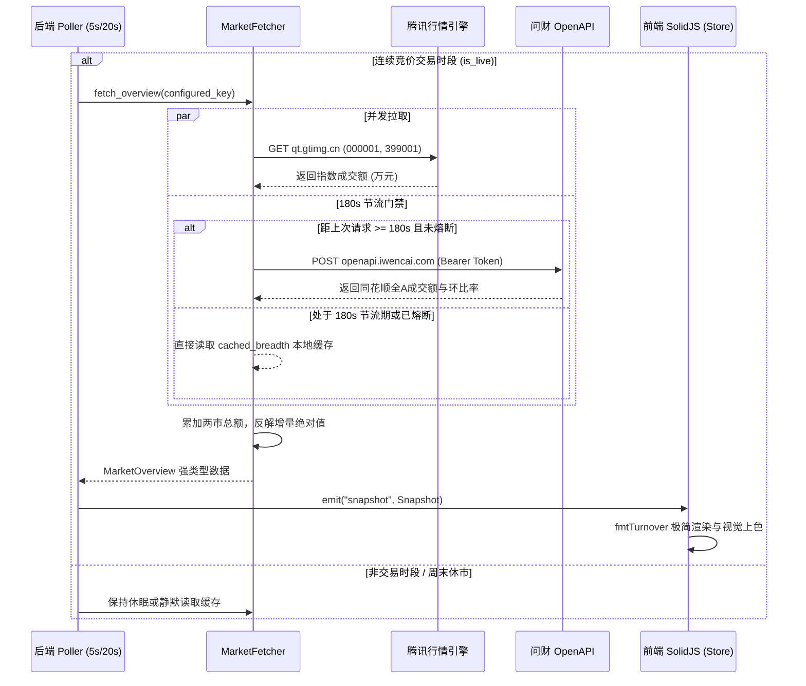

# 两市总成交额与环比放量缩量 (Market Volume) 需求与算法规范

> 模块分类：`market`  
> 适用标的：`大盘全景 (A股宏观全市场)`  
> 核心标签：`宏观全景 | 市场流动性 | 量价匹配 | 政策合规`  
> 对应代码实现：  
> - 后端数据拉取与总额计算：[src-tauri/src/market_overview/fetcher.rs](file:///D:/Project/private/ai/ai-finance-moyu/src-tauri/src/market_overview/fetcher.rs#L129-L181)  
> - 后端环比增长与增量推导：[src-tauri/src/market_overview/breadth.rs](file:///D:/Project/private/ai/ai-finance-moyu/src-tauri/src/market_overview/breadth.rs#L117-L165)  
> - 后端核心数据模型契约：[src-tauri/src/market_overview/types.rs](file:///D:/Project/private/ai/ai-finance-moyu/src-tauri/src/market_overview/types.rs#L77-L92)  
> - 前端数值格式化器：[src/types/format.ts](file:///D:/Project/private/ai/ai-finance-moyu/src/types/format.ts#L93-L103)  
> - 前端指数五维诊断引擎：[src/utils/indexDiagnosis.ts](file:///D:/Project/private/ai/ai-finance-moyu/src/utils/indexDiagnosis.ts#L62-L84)  
> - 前端全景看板组件：[src/layouts/Market.tsx](file:///D:/Project/private/ai/ai-finance-moyu/src/layouts/Market.tsx#L148-L181)  
> - 前端指数微标与弹窗卡片：[src/components/IndexBadge.tsx](file:///D:/Project/private/ai/ai-finance-moyu/src/components/IndexBadge.tsx#L70-L84)  
> - 前端全球与大盘时段状态徽标：[src/components/GlobalStatusBadge.tsx](file:///D:/Project/private/ai/ai-finance-moyu/src/components/GlobalStatusBadge.tsx#L1-L34)  
> - 前端横向胶囊条工具提示：[src/layouts/Bar.tsx](file:///D:/Project/private/ai/ai-finance-moyu/src/layouts/Bar.tsx#L94-L98)  
> 对应单元测试：  
> - 前端诊断与量能格式化测试：[src/utils/indexDiagnosis.test.ts](file:///D:/Project/private/ai/ai-finance-moyu/src/utils/indexDiagnosis.test.ts#L69-L103)  
> - 前端多布局挂载与宏观字段测试：[src/layouts/layouts.test.tsx](file:///D:/Project/private/ai/ai-finance-moyu/src/layouts/layouts.test.tsx#L113-L115)  
> - 后端全景数据拉取测试：[src-tauri/src/market_overview/mod.rs](file:///D:/Project/private/ai/ai-finance-moyu/src-tauri/src/market_overview/mod.rs#L66-L77)  
> - 后端智能熔断与基准回退测试：[src-tauri/src/market_overview/mod.rs](file:///D:/Project/private/ai/ai-finance-moyu/src-tauri/src/market_overview/mod.rs#L135-L151)  

---

## 1. 业务定位与看盘指引

### 1.1 业务定义与核心意图

- **定义**：两市总成交额（Market Total Turnover）是指上海证券交易所（上证）与深圳证券交易所（深证）在当日交易时段内所有已撮合成交股票的金额总和（单位：人民币元/亿元/万亿元）。成交额较昨日同时段环比变动率（`turnover_change_pct`）及增减绝对额（`turnover_change_amount`）则是衡量当前盘面相较于前一交易日同一分钟交投活跃度演进的核心衍生指标。
- **市场流动性水温计**：A 股市场具有鲜明的“资金推动型”与“散户与机构共存”博弈特征，素有“股市技术千万条，成交量是第一条”、“量在价先”之铁律。价格的上涨若无真金白银的成交量支持，往往是虚假反弹或主力诱多；反之，若暴跌伴随巨额抛压放量，则意味着流动性恐慌践踏。总成交额与环比放量/缩量构成了评估全市场整体风险偏好与流动性水温的绝对锚点。
- **桌面常驻看盘场景价值**：在打工人/交易者的桌面常驻悬浮或极窄摸鱼看盘状态下，用户无法时刻盯住数千只股票的分时图。通过在微型看板（`Market.tsx`）及指数卡片（`IndexBadge.tsx`）中精炼呈现“两市成交”与“较昨日放量/缩量”，用户只需扫视一眼（如 `2.15万亿 较昨日放量 +12.3%`），即可在 0.5 秒内对大盘真实流动性环境与持续性作出准确定性。
- **北向资金政策红线与替代方案（AGENTS.md 守则第 1 条）**：
  > [!IMPORTANT]
  > **北向资金政策红线**：根据中国证监会及沪深交易所统一政策，沪深港通已于 **2024 年 8 月 18 日**起正式调整信息披露机制，**盘中全面停止发布实时北向买入/卖出及净流入数据**，仅在盘后公布每日成交总额、ETF 交易及持仓总览。
  > 
  > 依据项目工程守则第 1 条，严禁在任何盘中界面设计、诱导或拉取“实时北向资金”（后端 [src-tauri/src/market_overview/fetcher.rs](file:///D:/Project/private/ai/ai-finance-moyu/src-tauri/src/market_overview/fetcher.rs#L249-L251) 的 `fetch_north_money` 显式硬编码返回 `Ok(0.0)` 予以阻断）。全软件所有宏观流动性监控与资金面指标**唯一聚焦并全面收口于“两市总成交额”及“较昨日同时段环比放量/缩量”**。

### 1.2 关键信号解读

在 `indexDiagnosis.ts` 五维穿透诊断引擎中，两市量能变动与大盘指数涨跌、全市场涨跌家数协同判定，形成标准化的定性评述与操盘指导：

| 市场形态 | 核心条件特征 | 诊断标识 (`code`) | 胶囊微标 (`badgeLabel`) | 操盘指引 (`guidance`) | 实况解读与行动指南 |
| :--- | :--- | :--- | :--- | :--- | :--- |
| **放量共振全面普涨** | 指数 $\ge +0.5\%$ 且放量 $\ge +5.0\%$ 且上涨个股 $\ge 75\%$ | `BULL_SURGE` | 🔥放量共振 | 【顺势看多】 | 两市真金白银放量进攻，多头动能充沛，赚钱效应爆发。此时阻力最小方向为向上，可顺势持股或跟进主线核心。 |
| **缩量冲高诱多风险** | 指数 $> +0.3\%$ 且缩量 $\le -5.0\%$ 且上涨个股 $< 65\%$ | `VOLUME_SHORT_PUMP` | ⚠️缩量冲高 | 【切忌追高】 | 指数虚涨但两市量能萎缩，呈现“买盘枯竭”存量博弈特征。极易在午后乏力冲高回落，严禁盲目追涨。 |
| **放量恐慌暴跌砸盘** | 指数 $\le -0.8\%$ 且放量 $\ge +5.0\%$ 且下跌个股 $\ge 75\%$ | `PANIC_DUMP` | ❄️放量恐慌 | 【多看少动】 | 市场遭遇非理性杀跌，放量踩踏出逃，恐慌盘与融资止损盘涌出。此时多头毫无承接，切莫伸手盲目“接飞刀”。 |
| **弱势阴跌无承接** | 指数 $< 0$ 且下跌个股 $\ge 60\%$（通常伴随缩量） | `BLEEDING_DRIFT` | 📉弱势阴跌 | 【防守控仓】 | 市场买盘极度匮乏，流动性呈阴跌钝化，温水煮青蛙，交投冷清。宜严格收缩战线，保留现金防守。 |
| **权重拉抬二八失血** | 指数 $\ge -0.05\%$ 但下跌个股 $\ge 60\%$ | `DIVERGE_INDEX_PUMP` | 🚨拉权护盘 | 【谨防诱多】 | 资金抱团大市值权重股生拉指数掩护出货，全市场超六成个股失血下跌，“赚了指数亏了钱”。 |
| **题材活跃八二行情** | 指数 $\le +0.15\%$ 但上涨个股 $\ge 65\%$ | `DIVERGE_BREADTH_PUMP` | 💎题材活跃 | 【轻指数重个股】 | 权重股压制大盘指数失真，但底层中小题材个股百花齐放，真实赚钱效应强劲，精选个股参与。 |
| **多空对峙窄幅蓄势** | 涨跌家数参半且量能平稳未达异动门槛 | `CONSOLIDATION` | ⚖️多空对峙 | 【观望蓄势】 | 涨跌互现，资金无序电风扇快速轮动，多空双方陷入胶着，耐心等待变盘信号。 |

#### 典型量价关系实战辅助指引
- **天量见天价（滞涨预警）**：若全日两市成交额突破阶段性天量（如超 2.5 万亿），但上证/深证指数涨幅明显收窄甚至收出放量长上影十字星，表明高位多空分歧剧烈，筹码已大量派发给追高散户，警惕变盘见顶。
- **地量见地价（冰点拐点）**：若连续多日成交额萎缩至历史极低分位（如不足 5000 亿），全市场波动钝化，表明市场抛压出清殆尽，随时孕育绝地反击的政策底/市场底。

### 1.3 UI 呈现与防窥规范

- **宿主组件分布**：
  1. `Market.tsx`（大盘全景模式）：宏观全景面板内的双列统计行 `.macro-stats-row` -> `.macro-stat-item`，左侧为「两市成交」，右侧为「较昨日」。
  2. `IndexBadge.tsx`（指数专属微标）：Hover 触发的双列卡片弹出层 `.index-card-grid` -> 左列「📊 资金量能」，展示「两市成交」与「量能变动」。
  3. `GlobalStatusBadge.tsx`：状态栏与头部全局股指交易时段彩色微标（交易中/盘前/午休/已收盘），作为宏观流动性拉取时段门禁的状态指示器。
  4. `Bar.tsx`（横向极简胶囊形态）：鼠标悬停于指数股票时的 Tooltip 浮窗，单行折叠展示 `两市成交: 1.80万亿 (较昨日放量 2280亿 (+14.5%))`。
- **图表与视觉规范**：
  - 动态涨跌色彩：放量采用多头鲜明红色（`--color-up` / `var(--color-up-subtle)` / 浅色模式 `#dc2626`）；缩量采用预警琥珀色/空头绿色（`--color-warning-light` / `--color-down` / 浅色模式 `#16a34a`）；持平采用中性灰（`--color-flat` / `#9ca3af`）。
  - 金额字样排印：数值部分统一绑定等宽无衬线字体 `var(--font-mono)`（如 Consolas / JetBrains Mono / SF Mono），避免金额快速跳动时产生界面横向抖动。
- **全主题自适应规范（AGENTS.md 守则第 15 条）**：
  - 严禁任何硬编码孤岛色，全面继承全局语义化 CSS 变量：
    - 暗色主题（`[data-theme="dark"]`）：卡片底色 `rgba(255, 255, 255, 0.03)`，边框 `rgba(255, 255, 255, 0.05)`，放量文本 `#f87171`。
    - 办公浅色（`[data-theme="light"]`）：卡片底色 `rgba(0, 0, 0, 0.035)`，边框 `rgba(0, 0, 0, 0.08)`，放量高对比度正红 `#dc2626`，缩量高对比度深绿 `#16a34a`，杜绝浅荧光色发飘。
- **极简防窥与降噪规范**：
  - 在外露紧凑卡片中，采用极简短语折叠（如 `放量 2280亿` 或 `缩量 1.26万亿`）。
  - 详尽细节（`较昨日放量 2280亿 (+14.5%)`）完全收纳至 DOM 原生 `title` 属性或微型 Hover 浮窗，杜绝在老板经过时因醒目大字泄露盯盘细节。

---

## 2. 数学公式与算法细节

### 2.1 依赖基础数据

系统通过双层异构数据通道捕获量能数据：

| 数据源 | 接口端点 / 协议 | 获取字段 / 参数 | 原始单位 | 用途 |
| :--- | :--- | :--- | :--- | :--- |
| **腾讯行情引擎** (`qt.gtimg.cn`) | HTTP GET GB18030 批量切片接口 | `s_sh000001` (上证) 字段 7<br>`s_sz399001` (深证) 字段 7 | 万元 (RMB 10,000) | 计算两市当前已发生撮合的绝对总成交额 |
| **同花顺问财 OpenAPI** (`openapi.iwencai.com`) | HTTP POST JSON 智能语义检索 | `query`: "同花顺全A ... 成交额 成交额环比增长率" | 环比增长率 (%)<br>同花顺全A总成交额 (元) | 获取较昨日同一分钟分时成交额的环比变动率与绝对增减量 |

### 2.2 核心数学公式与递推逻辑

```
  ┌────────────────────────────────────────────────────────┐
  │                 两市总成交额与增量计算管线                 │
  └───────────────────────────┬────────────────────────────┘
                              │
         ┌────────────────────┴────────────────────┐
         ▼                                         ▼
   [腾讯行情接口]                             [同花顺问财]
  s_sh000001, s_sz399001                    同花顺全A 环比增长率
         │                                         │
         ▼                                         ▼
   $T_{sh}, T_{sz}$ (万元)                    $P_{change}$ (%), $T_{wencai}$
         │                                         │
         ▼                                         ▼
两市总额: $T_{total} = (T_{sh}+T_{sz})\times 10^4$  增量推导: $\Delta T = T \cdot \frac{P_{change}}{100 + P_{change}}$
         │                                         │
         └────────────────────┬────────────────────┘
                              │
                              ▼
                   [IPC 推送: MarketOverview]
                    total_turnover: $T_{total}$
                    turnover_change_pct: $P_{change}$
                    turnover_change_amount: $\Delta T$
                              │
                              ▼
                   [前端 fmtTurnover 格式化]
                    $\ge 10^{12} \to X.XX$ 万亿
                    $\ge 10^8 \to X$ 亿
```

#### 1. 两市总成交额公式
上证综指（`000001`）与深证成指（`399001`）涵盖了沪深主板、科创板及创业板全部上市证券。两市总成交额 $T_{\text{total}}$ 满足：
$$T_{\text{total}} = T_{\text{sh}} + T_{\text{sz}} = (\text{turnover\_wan}_{\text{sh}} + \text{turnover\_wan}_{\text{sz}}) \times 10{,}000$$

#### 2. 成交额人性化单位格式化算法 (`fmtTurnover`)
前端 [src/types/format.ts](file:///D:/Project/private/ai/ai-finance-moyu/src/types/format.ts#L93-L103) 实施自适应阶梯缩减算法：
$$\text{fmtTurnover}(T) = \begin{cases} 
\text{toFixed}(T / 10^{12}, 2) + \text{"万亿"}, & T \ge 10^{12} \\
\text{toFixed}(T / 10^8, 0) + \text{"亿"}, & 10^8 \le T < 10^{12} \\
\text{toFixed}(T / 10^4, 0) + \text{"万"}, & 10^4 \le T < 10^8 \\
\text{"--"}, & T \le 0 \text{ 或 } T \text{ 为 null / undefined}
\end{cases}$$

#### 3. 成交额较昨日同时段环比变动率
设今日盘中 $t$ 时刻两市成交额为 $T_{\text{today}}(t)$，昨日盘中 $t$ 时刻两市成交额为 $T_{\text{yesterday}}(t)$，则环比增长率 $P_{\text{change}}$ 严格满足：
$$P_{\text{change}} = \frac{T_{\text{today}}(t) - T_{\text{yesterday}}(t)}{T_{\text{yesterday}}(t)} \times 100\%$$

#### 4. 较昨日成交额增量绝对值反解推导公式
同花顺问财接口在返回全市场大盘全景时，直接返回今日当前时刻累计成交额 $T_{\text{today}}$ 与环比变动率 $P_{\text{change}}$。为了在 UI 上精确外露“放量/缩量多少亿元”，Rust 后端 [src-tauri/src/market_overview/breadth.rs](file:///D:/Project/private/ai/ai-finance-moyu/src-tauri/src/market_overview/breadth.rs#L144-L153) 实施代数反解：
根据定义：
$$1 + \frac{P_{\text{change}}}{100} = \frac{T_{\text{today}}}{T_{\text{yesterday}}}$$
反解昨日同时段基准成交额：
$$T_{\text{yesterday}} = \frac{T_{\text{today}}}{1 + \frac{P_{\text{change}}}{100}} = \frac{T_{\text{today}} \times 100}{100 + P_{\text{change}}}$$
两市成交额较昨日增减绝对值 $\Delta T = T_{\text{today}} - T_{\text{yesterday}}$ 为：
$$\Delta T = T_{\text{today}} - \frac{T_{\text{today}} \times 100}{100 + P_{\text{change}}} = T_{\text{today}} \times \left(1 - \frac{100}{100 + P_{\text{change}}}\right) = T_{\text{today}} \times \frac{P_{\text{change}}}{100 + P_{\text{change}}}$$

代码对应实现：
```rust
let turnover_change_amount = match (turnover_val, turnover_change_pct) {
    (Some(turnover), Some(pct)) => {
        if (100.0 + pct).abs() > 1e-4 {
            Some(turnover * (pct / (100.0 + pct)))
        } else {
            None
        }
    }
    _ => None,
};
```

### 2.3 边界情况与冷启动处理

1. **除零与极端物理保护**：当市场遭遇极端行情出现 $P_{\text{change}} \to -100\%$ 时，公式分母 $100.0 + P_{\text{change}} \to 0$。算法引入 `(100.0 + pct).abs() > 1e-4` 浮点防御门限，防止产生 `NaN` 或 `Infinity`。
2. **基准缓存数据兜底（Baseline Fallback Cache）**：
   - 当用户首次启动应用未配置问财 API Key、网络断网超时、或遭遇 HTTP 429 熔断时，系统立即平滑退守至内嵌的基准数据快照：
     ```rust
     cached_breadth: std::sync::Mutex::new((
         1167,                    // 涨家数
         4324,                    // 跌家数
         69,                      // 平家数
         Some(-19.09),            // 环比增长率: -19.09%
         Some(-365_890_000_000.0) // 增减绝对值: -3658.9 亿元
     ))
     ```
   - 彻底避免界面出现“全 0”、“NaN”或白屏崩溃，保障大盘全景在离线或弱网下依然优雅呈现。
3. **早盘开盘冷启动（09:30 前）**：在早盘 09:15-09:25 集合竞价阶段，成交额仅为竞价匹配金额，尚未形成连续交易。若成交额为 0 或未解析到有效值，`fmtTurnover` 返回 `--`，界面标签静默显示 `量能持平`。

---

## 3. 数据契约与时段规则

### 3.1 上游数据链路与职责划分



- **职责明晰与计算收口（AGENTS.md 守则第 4、11 条）**：
  - **Rust 后端**：唯一承载系统网络调用、GB18030 字符解码、万元到元单位换算、环比绝对增减额代数推导、智能熔断与基准缓存管理。
  - **SolidJS 前端**：保持轻量呈现（Thin Presentation Layer），仅通过强类型 IPC 事件接收 `MarketOverview`，执行纯函数格式化，严禁在前端 WebView 中直接发起跨域网络请求。
- **刷新频率分层设计**：
  - 指数总成交额：在 `Market`（大盘看板）模式下每 **5 秒**轮询一次，其他模式每 **20 秒**轮询一次。
  - 问财全市场环比数据：鉴于全市场交投演进具有宏观连续性且第三方 API 配额稀缺，后端在 [src-tauri/src/market_overview/breadth.rs](file:///D:/Project/private/ai/ai-finance-moyu/src-tauri/src/market_overview/breadth.rs#L33-L43) 中配置硬编码 **180 秒（3 分钟）智能时钟节流**，严禁高频频繁请求。

### 3.2 接口智能熔断与异常退避守则 (Circuit Breaker & Backoff)

遵循 AGENTS.md 守则第 5 条：
1. **熔断判定条件**：当同花顺问财接口响应满足以下任意特征时，立即锁定单日智能熔断：
   - HTTP 状态码为 `401 Unauthorized`（Token 无效或过期）；
   - HTTP 状态码为 `429 Too Many Requests`（触发频次限流）；
   - 响应体内容包含 `次数已用完` 等配额耗尽特征。
2. **熔断执行逻辑**：
   ```rust
   *self.quota_exhausted_date.lock().unwrap_or_else(|e| e.into_inner()) = Some(today);
   log::info!(target: "NET", "问财接口配额耗尽/鉴权受限 (HTTP {status})，已启动今日熔断并平滑回退基准缓存");
   let cached = *self.cached_breadth.lock().unwrap_or_else(|e| e.into_inner());
   return Ok(cached);
   ```
   熔断激活后，当日后续所有定时轮询直接在第一道门禁拦截，直接返回基准缓存，绝不产生二次网络开销，防止 IP 被远端服务拉黑。
3. **熔断恢复与探测重置**：
   - **自然日跨日**：次日首个交易日，日期比对自动失效，解除熔断。
   - **用户主动重置**：当用户在设置面板重新填写或更新问财 API Key 并保存时，后端自动触发 [reset_quota_circuit_breaker()](file:///D:/Project/private/ai/ai-finance-moyu/src-tauri/src/market_overview/fetcher.rs#L64-L68)，清空熔断标记与节流时间戳，即刻发起探活。

### 3.3 A 股交易时段门禁

系统严格对照 A 股交易时段划分（[src-tauri/src/market/mod.rs](file:///D:/Project/private/ai/ai-finance-moyu/src-tauri/src/market/mod.rs#L6-L39) 中的 `Session` 及 `is_live()`）：

| 时段区间 | 业务阶段 (`Session`) | `is_live()` | 两市总成交额与环比行为规范 |
| :--- | :--- | :--- | :--- |
| `00:00 - 09:14` | `PreOpen` (盘前就绪) | `false` | 休眠。展示上一交易日收盘成交总额快照，不发起问财网络查询。 |
| `09:15 - 09:19` | `CallAuctionCancelable` (早盘竞价可撤单) | `true` | 允许网络请求，总成交额为初步试撮合金额，交投处于极早起步阶段。 |
| `09:20 - 09:24` | `CallAuctionLocked` (早盘竞价不可撤单) | `true` | 撮合意向锁定，成交量能快速沉淀。 |
| `09:25 - 09:29` | `PreTrade` (静默期) | `false` | **非 live 时段**。问财接口返回缓存，指数锁定今日开盘价与竞价总额。 |
| `09:30 - 11:30` | `Morning` (早盘连续交易) | `true` | 核心活跃期。每 5s/20s 刷新总成交额，问财每 180s 刷新环比变动率。 |
| `11:31 - 12:59` | `LunchBreak` (午间休市) | `false` | **非 live 时段**。休眠待机，冻结上午最终成交额，静默等待午后开盘。 |
| `13:00 - 14:56` | `Afternoon` (午后连续交易) | `true` | 核心活跃期。持续追踪午后放量拉升或缩量钝化态势。 |
| `14:57 - 15:00` | `ClosingAuction` (尾盘集合竞价) | `true` | 最终撮合期。决定全天两市最终总成交额及最终定盘环比增减额。 |
| `15:01 - 23:59` | `Closed` (已收盘) | `false` | 停机归档。维持全天最终成交快照，防止无意义的网络空耗。 |
| 周六 / 周日 | `Closed` (周末休市) | `false` | 停机归档。维持周五收盘快照，启动低频降级探活。 |

---

## 4. 告警阈值与防扰规范

### 4.1 触发判定规则

在前端 [src/utils/indexDiagnosis.ts](file:///D:/Project/private/ai/ai-finance-moyu/src/utils/indexDiagnosis.ts#L62-L65) 中定义了两市量能变动的硬性离散判定门限：

```ts
const turnoverPct = overview?.turnoverChangePct ?? 0
const isVolumeSurge = turnoverPct >= 5.0    // 显著放量门限 (+5.0%)
const isVolumeShrink = turnoverPct <= -5.0  // 显著缩量门限 (-5.0%)
```

- **放量极值梯度**：
  - $P_{\text{change}} \ge +5.0\%$：判定为【显著放量】（`isVolumeSurge = true`），资金入场迹象明显。
  - $P_{\text{change}} \ge +15.0\%$：判定为【爆量狂热】，多头情绪高度亢奋，若个股普涨则强化为 `BULL_SURGE`，若个股普跌则强化为 `PANIC_DUMP`。
- **缩量极值梯度**：
  - $P_{\text{change}} \le -5.0\%$：判定为【显著缩量】（`isVolumeShrink = true`），交投热度冷却。
  - $P_{\text{change}} \le -20.0\%$：判定为【深度冰点缩量】，存量博弈极度严重，冲高反弹极易被定义为 `VOLUME_SHORT_PUMP` 诱多。
- **持平中性区间**：
  - $-5.0\% < P_{\text{change}} < +5.0\%$：判定为【量能平稳】，归类为多空对峙或温和走势。

### 4.2 节流防轰炸与静音机制

- **严禁系统级桌面弹窗通知（Notification Anti-Disturbance Invariant）**：
  - 两市总成交额与放量/缩量属于**宏观背景板指标**，不属于单股止盈止损突变。
  - 严格禁止针对两市成交额突变向 Windows 系统推送任何桌面级别 Toast 弹窗（遵循 AGENTS.md 守则第 3 条与第 7 条），杜绝在办公摸鱼场景下因宏观量能频繁波动产生弹窗轰炸。
- **状态徽标微光感知**：
  - 所有流动性异动仅通过卡片内的微型状态标签、微标色温（红色放量/黄色缩量）、以及文字解读（如“较昨日放量 2280亿”）实施静默无感呈现。
- **分级日志分类与审计留痕（AGENTS.md 守则第 7 条）**：
  - 统一收口于标准 `log` Facade，指定 Target 为 `NET`：
    - `log::info!(target: "NET", "同花顺全景统计拉取成功: 涨={}, 跌={}, 平={}, 成交额环比={:?}%", ...)`
    - `log::info!(target: "NET", "问财接口配额耗尽/鉴权受限 (HTTP {status})，已启动今日熔断并平滑回退基准缓存")`
    - `log::debug!(target: "NET", "涨跌统计拉取成功: 涨={u}, 跌={d}, 平={f}, 环比={pct:?}")`
  - 日志自动写入 `%APPDATA%/.../logs/app.log`，单文件 5MB 上限，保留最新 3 份，内存环形队列保留最近 200 条供设置面板筛选，严禁无节流的高频 `println!`。

---

## 5. 验收基准与测试对齐

### 5.1 黄金测试用例 (Golden Fixture)

#### 用例 1：基准缓存平滑保底（无 Token 或触发熔断）
- **输入特征**：网络超时或未配置问财 Token，触发 `cached_breadth` 默认值。
  - `up_count = 1167`, `down_count = 4324`, `flat_count = 69`
  - `turnover_change_pct = Some(-19.09)`
  - `turnover_change_amount = Some(-365_890_000_000.0)`
  - `total_turnover = 1_550_000_000_000.0` (1.55万亿)
- **预期确定性输出**：
  - `totalTurnoverText` = `"1.55万亿"`
  - `turnoverDeltaText` = `"缩量 3659亿"`
  - `turnoverDeltaDetail` = `"较昨日缩量 3659亿 (-19.1%)"`
  - `isVolumeSurge` = `false`
  - `isVolumeShrink` = `true`

#### 用例 2：放量共振普涨爆发行情 (`BULL_SURGE`)
- **输入特征**：
  - 指数涨幅：`changePct = +1.35%`
  - 市场广度：`up = 4300`, `down = 700`, `flat = 100` (上涨占比 84%)
  - 两市量能：`totalTurnover = 1_800_000_000_000.0` (1.80万亿)
  - 环比变动率：`turnoverChangePct = +14.5%`
  - 理论增量：$\Delta T = 1.8 \times 10^{12} \times \frac{14.5}{100 + 14.5} \approx 2.27947 \times 10^{11}$ 元 (约 $+2280$ 亿)
- **预期确定性输出**：
  - `code` = `'BULL_SURGE'`
  - `badgeLabel` = 包含 `"🔥放量共振 (84%涨)"`
  - `guidance` = `"【顺势看多】"`
  - `turnoverDeltaText` = `"放量 2280亿"`
  - `turnoverDeltaDetail` = `"较昨日放量 2280亿 (+14.5%)"`

#### 用例 3：极端缩量反弹诱多 (`VOLUME_SHORT_PUMP`)
- **输入特征**：
  - 指数涨幅：`changePct = +0.75%`
  - 市场广度：`up = 2600`, `down = 2300`, `flat = 100` (上涨占比 52%)
  - 环比变动率：`turnoverChangePct = -8.5%`
  - 变动绝对值：`turnoverChangeAmount = -120_000_000_000.0` (-1200亿)
- **预期确定性输出**：
  - `code` = `'VOLUME_SHORT_PUMP'`
  - `badgeLabel` = 包含 `"⚠️缩量冲高 (52%涨)"`
  - `guidance` = `"【切忌追高】"`
  - `tone` = `'warn'`
  - `turnoverDeltaText` = `"缩量 1200亿"`

#### 用例 4：万亿级别极端缩量与文本防溢出验证
- **输入特征**：
  - 两市成交额：`totalTurnover = 1_800_000_000_000.0` (1.80万亿)
  - 环比变动率：`turnoverChangePct = -81.9%`
  - 变动绝对值：`turnoverChangeAmount = -1_260_000_000_000.0` (-1.26万亿)
- **预期确定性输出**：
  - `turnoverDeltaText` = `"缩量 1.26万亿"` (验证万亿级别格式化精确输出，杜绝超长文字折行)
  - `turnoverDeltaDetail` = `"较昨日缩量 1.26万亿 (-81.9%)"`

#### 用例 5：腾讯行情万元转元累加计算
- **输入特征**：
  - 上证指数（`s_sh000001`）返回 `turnover_wan = 85234567.0` (8523.4567 亿元)
  - 深证成指（`s_sz399001`）返回 `turnover_wan = 96765433.0` (9676.5433 亿元)
- **预期确定性输出**：
  - `total_turnover` = $(85234567.0 + 96765433.0) \times 10000.0 = 1,820,000,000,000.0$ 元
  - 前端输出 `fmtTurnover(1.82e12)` = `"1.82万亿"`

---

### 5.2 代码与测试映射 (Traceability Matrix)

| 规范要素 | 核心实现/测试文件 | 代码行号区间 | 核心职责说明 |
| :--- | :--- | :--- | :--- |
| **数据结构定义** | [src-tauri/src/market_overview/types.rs](file:///D:/Project/private/ai/ai-finance-moyu/src-tauri/src/market_overview/types.rs#L77-L92) | L77–L92 | 定义 `MarketOverview`，承载 `total_turnover`, `turnover_change_pct`, `turnover_change_amount` |
| **成交额拉取与转换** | [src-tauri/src/market_overview/fetcher.rs](file:///D:/Project/private/ai/ai-finance-moyu/src-tauri/src/market_overview/fetcher.rs#L129-L181) | L129–L181 | 请求腾讯接口，解码 GB18030，提取万元成交额并转换累加为两市总额（元） |
| **北向资金合规拦截** | [src-tauri/src/market_overview/fetcher.rs](file:///D:/Project/private/ai/ai-finance-moyu/src-tauri/src/market_overview/fetcher.rs#L249-L251) | L249–L251 | `fetch_north_money` 硬编码返回 `Ok(0.0)`，严格遵守 2024年8月北向停发政策红线 |
| **环比率与增量推导** | [src-tauri/src/market_overview/breadth.rs](file:///D:/Project/private/ai/ai-finance-moyu/src-tauri/src/market_overview/breadth.rs#L117-L153) | L117–L153 | 解析问财响应中的环比增长率，基于代数公式反解增量绝对值 $\Delta T$ |
| **智能熔断与基准缓存** | [src-tauri/src/market_overview/breadth.rs](file:///D:/Project/private/ai/ai-finance-moyu/src-tauri/src/market_overview/breadth.rs#L85-L94) | L85–L94 | 监测 401/429/次数用完，触发单日熔断并回退至基准缓存 |
| **基准缓存初值与重置** | [src-tauri/src/market_overview/fetcher.rs](file:///D:/Project/private/ai/ai-finance-moyu/src-tauri/src/market_overview/fetcher.rs#L27-L37) | L27–L37, L64–L68 | 维护 `(-19.09%, -3658.9亿)` 基准缓存，提供 `reset_quota_circuit_breaker` |
| **180s 节流与交易门禁** | [src-tauri/src/market_overview/breadth.rs](file:///D:/Project/private/ai/ai-finance-moyu/src-tauri/src/market_overview/breadth.rs#L26-L43) | L26–L43 | 门禁判断 `!session.is_live()` 及 180s 节流保护 |
| **金额单位格式化** | [src/types/format.ts](file:///D:/Project/private/ai/ai-finance-moyu/src/types/format.ts#L93-L103) | L93–L103 | `fmtTurnover` 阶梯转换算法（元 $\to$ 万/亿/万亿） |
| **指数穿透诊断引擎** | [src/utils/indexDiagnosis.ts](file:///D:/Project/private/ai/ai-finance-moyu/src/utils/indexDiagnosis.ts#L62-L84) | L62–L84, L164–L210 | `isVolumeSurge` / `isVolumeShrink` 阈值标定与量价五维模式定性 |
| **大盘全景看板呈现** | [src/layouts/Market.tsx](file:///D:/Project/private/ai/ai-finance-moyu/src/layouts/Market.tsx#L148-L181) | L148–L181 | 渲染 `.macro-stats-row` 两市成交与较昨日放量/缩量徽标 |
| **指数诊断微标卡片** | [src/components/IndexBadge.tsx](file:///D:/Project/private/ai/ai-finance-moyu/src/components/IndexBadge.tsx#L70-L84) | L70–L84 | 渲染 2-Column Grid 卡片左列「📊 资金量能」与 Tooltip |
| **时段状态彩色圆点** | [src/components/GlobalStatusBadge.tsx](file:///D:/Project/private/ai/ai-finance-moyu/src/components/GlobalStatusBadge.tsx#L1-L34) | L1–L34 | 渲染全球股指与 A 股时段彩色圆点徽标 |
| **前端诊断自动化测试** | [src/utils/indexDiagnosis.test.ts](file:///D:/Project/private/ai/ai-finance-moyu/src/utils/indexDiagnosis.test.ts#L69-L103) | L69–L103, L180–L202 | 验证放量共振、缩量冲高、放量恐慌及万亿级缩量精炼文本 |
| **前端布局快照测试** | [src/layouts/layouts.test.tsx](file:///D:/Project/private/ai/ai-finance-moyu/src/layouts/layouts.test.tsx#L113-L115) | L113–L115 | 验证全景快照数据结构与多布局挂载 |
| **后端熔断单元测试** | [src-tauri/src/market_overview/mod.rs](file:///D:/Project/private/ai/ai-finance-moyu/src-tauri/src/market_overview/mod.rs#L135-L151) | L135–L151 | `test_quota_circuit_breaker` 验证熔断锁定与重置行为 |
| **后端网络拉取测试** | [src-tauri/src/market_overview/mod.rs](file:///D:/Project/private/ai/ai-finance-moyu/src-tauri/src/market_overview/mod.rs#L66-L77) | L66–L77 | `test_live_market_fetch` 验证指数拉取与总额计算 |
