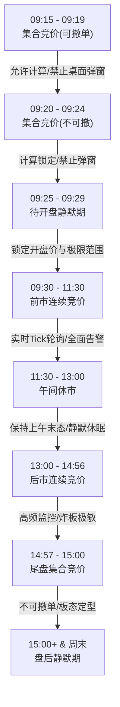

# 涨跌停与炸板监控 (Limit Board Monitor) 需求与算法规范

> 模块分类：`tape`  
> 适用标的：`个股`  
> 核心标签：`高频异动 | 盘口板态 | 极致流动性 | 风险预警`  
> 对应代码实现：  
> - 后端检测核心：[limit_board.rs](file:///D:/Project/private/ai/ai-finance-moyu/src-tauri/src/trend_engine/limit_board.rs#L10-L94)  
> - 后端异动状态机：[limit_board.rs](file:///D:/Project/private/ai/ai-finance-moyu/src-tauri/src/crossing/limit_board.rs#L86-L241)  
> - 涨跌停价计算：[market/mod.rs](file:///D:/Project/private/ai/ai-finance-moyu/src-tauri/src/market/mod.rs#L196-L215)  
> - 信号模型与分值：[trend_engine/types.rs](file:///D:/Project/private/ai/ai-finance-moyu/src-tauri/src/trend_engine/types.rs#L51-L58)  
> - 前端诊断与渲染：[StockBadge.tsx](file:///D:/Project/private/ai/ai-finance-moyu/src/components/StockBadge.tsx#L21-L126)、[stockDiagnosis.ts](file:///D:/Project/private/ai/ai-finance-moyu/src/utils/stockDiagnosis.ts#L60-L64)  
> 对应单元测试：  
> - 趋势引擎流转测试：[flow.rs](file:///D:/Project/private/ai/ai-finance-moyu/src-tauri/src/trend_engine/tests/flow.rs#L91-L137)  
> - 盘口异动状态机测试：[anomaly.rs](file:///D:/Project/private/ai/ai-finance-moyu/src-tauri/src/crossing/tests/anomaly.rs#L60-L109)  
> - 涨跌停价精度测试：[market/tests.rs](file:///D:/Project/private/ai/ai-finance-moyu/src-tauri/src/market/tests.rs#L142-L174)  

---

## 1. 业务定位与看盘指引

### 1.1 业务定义与核心意图
- **业务定义**：  
  A股市场实行独特的每日涨跌幅限制制度（主板 $\pm10\%$、创业板/科创板 $\pm20\%$、北交所 $\pm30\%$、ST板块 $\pm5\%$）。当股票触及涨跌幅上限或下限时，价格被制度性锚定，买卖盘口出现极端的不对称性（真空现象）。  
  【涨跌停与炸板监控 (Limit Board Monitor)】是本项目**优先级最高（Pattern 0 绝对优先）**的盘口微观结构检测引擎与异动报警器，涵盖**封死涨停（SealedLimitUp）**、**封死跌停（SealedLimitDown）**、**涨停炸板（BrokenLimitUp）**、**跌停撬板（BrokenLimitDown）**四大核心极值形态，以及**封单松动（SealLoosening）**与**逼近涨跌停（NearLimitUp / NearLimitDown）**先兆预警。
- **看盘痛点与价值**：  
  在摸鱼或桌面微型常驻看盘场景下，交易者不可能时刻紧盯买一卖一五档申报变动：
  1. **流动性枯竭陷阱（跌停）**：封死跌停意味着买盘彻底真空，流动性丧失，持仓者挂单无法成交，严禁“伸手接飞刀”；
  2. **隔夜溢价锁定（涨停）**：封死涨停是多头最强进攻信号，主力巨量锁仓带来次日高开溢价预期，指引交易者顺势持股；
  3. **主力高位出逃预警（炸板）**：涨停板被大单砸开往往伴随主力资金借狂热情绪“开板出货”，若不及时察觉将遭遇从 $+10\%$ 跳水至翻绿的日内重创，监控器第一时间发出“⚠️ 炸板减仓”报警；
  4. **极端博弈与绝境自救（撬板）**：跌停被巨额神秘资金撬开，通常带来剧烈的多空换手日内反抽（地天板博弈），为深套持仓者提供宝贵的降本控仓窗口。

### 1.2 关键信号解读

| 信号标识 (State) | 核心特征与盘口现象 | 操盘指引与含义 | 多空能量分值 | UI微标显示 (Badge) |
| :--- | :--- | :--- | :--- | :--- |
| **`SealedLimitUp`**<br>(封死涨停) | 现价等于涨停价，卖盘五档完全真空（卖一量 $\le 0.001$ 手），买一巨量排队封单。 | **顺势持股**：享受多头强势锁仓与次日高开溢价，持股待涨，切忌盲目下车。 | **`+100`** | `🔒 封死涨停 · 顺势持股`<br>紧凑态：`涨停(持)` |
| **`BrokenLimitUp`**<br>(涨停炸板) | 日内曾触及涨停，但涨停封单被砸穿，现价自涨停价跌落超 $0.02$ 元且涨幅较涨停落后超 $0.5\%$。 | **逢高减仓**：高位筹码剧烈分歧松动，警惕主力大单对倒出货或获利盘兑现，防范高台跳水。 | **`+30`** | `⚡ 涨停炸板 · 逢高减仓`<br>紧凑态：`炸板(减)` |
| **`SealedLimitDown`**<br>(封死跌停) | 现价等于跌停价，买盘五档完全真空（买一量 $\le 0.001$ 手），卖一巨量恐慌压盘。 | **观望封单**：流动性完全枯竭无法即时成交，严禁伸手接飞刀，密切监控封单增减。 | **`-100`** | `🔒 封死跌停 · 观望封单`<br>紧凑态：`跌停(锁)` |
| **`BrokenLimitDown`**<br>(跌停撬板) | 日内曾触及跌停，现价脱离跌停价超 $0.02$ 元且跌幅较跌停收窄超 $0.5\%$。 | **资金博弈**：跌停板被巨量撬板资金敲开，日内换手剧烈，持仓者借反抽择机减仓自救。 | **`-35`** | `⚡ 跌停翘板 · 资金博弈`<br>紧凑态：`翘板(察)` |
| **`SealLoosening`**<br>(封单骤降/松动) | 涨停封死状态下，买一封单量较日内峰值骤降 $\ge 60\%$（且峰值 $\ge 1000$ 手）。 | **谨防炸板**：主力撤单或隐蔽大单撤退，炸板临界警报，提示盯盘防守。 | *(状态机事件)* | 系统提示：`⚡封单骤降(-xx%)` |
| **`NearLimitUp` / `Down`**<br>(逼近涨跌停) | 现价逼近涨跌停价格 $0.5\%$ 或差额 $\le 0.02$ 元以内，尚未完全封死。 | **临界博弈**：即将封板或破位，提示关键分水岭。 | *(状态机事件)* | 系统提示：`🔴逼近涨停` / `🟢逼近跌停` |

### 1.3 UI 呈现与防窥规范
- **宿主组件**：  
  主要由前端 [StockBadge.tsx](file:///D:/Project/private/ai/ai-finance-moyu/src/components/StockBadge.tsx#L21-L126)（别名 `TrendBadge.tsx`）承载渲染，并与 [StockBadgePopover.tsx](file:///D:/Project/private/ai/ai-finance-moyu/src/components/StockBadgePopover.tsx) 形成两级联动。同时，跨越阈值异动由后端的系统桌面级通知（Windows Toast）与系统通知托盘协同提示。
- **图表与视觉规范**：  
  严格遵循 [AGENTS.md](file:///D:/Project/private/ai/ai-finance-moyu/AGENTS.md) 第 15 条「全主题自适应与防窥视觉规范」：
  - 封死涨停：绑定语义变量 `var(--badge-bull-bg)` 与高对比度红字 `var(--badge-bull-text)`，背景带有微妙的微光感；
  - 封死跌停：绑定语义变量 `var(--badge-bear-bg)` 与高对比度绿字 `var(--badge-bear-text)`；
  - 炸板 / 撬板：绑定警示黄色系 `var(--badge-warn-bg)` 与 `var(--badge-warn-text)`；
  - 严禁硬编码静态 RGB 颜色，完全消除在浅色主题下的视觉孤岛。
- **全主题自适应**：  
  - 「深邃暗黑（Dark）」：深红底亮红字、深绿底翡翠字、暗金底警示黄字；
  - 「办公浅色（Light）」：饱满高对比度正红（`#dc2626`）、深翡翠绿（`#16a34a`）以及警戒琥珀色（`#d97706`），确保低反差光照下清晰易读。
- **极简防窥要求**：  
  在悬浮挂件收起态或迷你列表态下，自动剥除冗余长文本，缩写为极致防窥的 4 字符徽标（如 `涨停(持)`、`炸板(减)`、`跌停(锁)`、`翘板(察)`），配合居中多空能量条（$\pm 100$ 分满格渲染），实现 1 秒内余光扫视即掌握极限风险。

---

## 2. 数学公式与算法细节

### 2.1 依赖基础数据
本指标依赖实时 Tick 快照与 L1/L5 盘口深度数据（`Quote` 结构体），核心输入字段包括：
- `quote.code`：标准化证券代码（如 `sh600000`, `sz300750`, `bj830799`）；
- `quote.name`：证券名称（用于判定是否包含 `ST`，以及排除 `N`/`C` 开头的新股）；
- `quote.price`：实时成交现价（元）；
- `quote.pre_close`：昨收盘基准价（元，必须 $> 0.0$）；
- `quote.high`：日内最高成交价（元）；
- `quote.low`：日内最低成交价（元）；
- `quote.change_pct`：实时涨跌幅百分比（如 `+10.0` 表示 $+10.0\%$）；
- `quote.bids`：买盘五档队列 `Vec<(price, volume)>`（其中第 1 档买一量为 `bids[0].1`，单位：手）；
- `quote.asks`：卖盘五档队列 `Vec<(price, volume)>`（其中第 1 档卖一量为 `asks[0].1`，单位：手）；
- `quote.bid_ask_imbalance`：盘口买卖失衡度（取值区间 $[-1.0, +1.0]$）。

### 2.2 核心数学公式与递推逻辑

#### 2.2.1 各板块涨跌停价格基准精确计算
根据沪深北交易所交易规则，价格变动幅度基于 `pre_close` 计算，并严格四舍五入精确到分（2位小数）：

```math
\text{Ratio} = 
\begin{cases} 
0.30, & \text{代码以 bj8, bj43, bj92 开头 (北交所)} \\
0.20, & \text{代码以 sz30, sh68 开头 (创业板 / 科创板)} \\
0.05, & \text{股票简称包含 "ST" (风险警示标的)} \\
0.10, & \text{其他主板标的 (沪市60, 深市00)}
\end{cases}
```

涨跌停价格四舍五入精确算式：
```math
\text{LimitUp} = \frac{\lfloor \text{pre\_close} \times (1 + \text{Ratio}) \times 100 + 0.5 \rfloor}{100} = \frac{\text{round}(\text{pre\_close} \times (1 + \text{Ratio}) \times 100)}{100}
```
```math
\text{LimitDown} = \frac{\lfloor \text{pre\_close} \times (1 - \text{Ratio}) \times 100 + 0.5 \rfloor}{100} = \frac{\text{round}(\text{pre\_close} \times (1 - \text{Ratio}) \times 100)}{100}
```

> [!NOTE] 浮点数舍入示例
> 平安银行（`sz000001`）昨收盘价 $9.45$ 元：  
> 理论涨停价 $= 9.45 \times 1.10 = 10.395$ 元，四舍五入后精确为 **$10.40$** 元；  
> 理论跌停价 $= 9.45 \times 0.90 = 8.505$ 元，四舍五入后精确为 **$8.50$** 元。

#### 2.2.2 盘口真空与封死判定 (Sealed Limit Detection)
由于浮点计算存在微小精度误差，工程上统一采用浮点容差 $\epsilon = 0.005$ 元作为触板缓冲带：
1. **封死涨停判定**：
   - 现价触及涨停：
     $$\text{price} \ge \text{LimitUp} - 0.005$$
   - 卖档真空（满足任一条件即视为真空）：
     $$\text{sell1\_vol} \le 0.001 \quad \lor \quad \text{asks.is\_empty}() \quad \lor \quad \text{bid\_ask\_imbalance} \ge 0.90$$
   - 封单量级描述格式化：
     $$\text{seal\_desc} = 
     \begin{cases} 
     \text{format!("{:.1}万手", buy1\_vol / 10000.0)}, & \text{buy1\_vol} \ge 10000.0 \\
     \text{format!("{:.0}手", buy1\_vol)}, & \text{buy1\_vol} > 0.0 \\
     \text{"巨额"}, & \text{其他}
     \end{cases}$$
   - 输出状态：`TrendState::SealedLimitUp`，能量分 $+100$。

2. **封死跌停判定**：
   - 现价触及跌停：
     $$\text{price} \le \text{LimitDown} + 0.005$$
   - 买档真空（满足任一条件即视为真空）：
     $$\text{buy1\_vol} \le 0.001 \quad \lor \quad \text{bids.is\_empty}() \quad \lor \quad \text{bid\_ask\_imbalance} \le -0.90$$
   - 封单量级描述：以 `sell1_vol` 按相同量级格式化。
   - 输出状态：`TrendState::SealedLimitDown`，能量分 $-100$。

#### 2.2.3 涨停炸板判定 (Broken Limit Up)
为了精准捕捉“曾经封板、后被大单砸开”的真实破板场景，同时过滤掉贴板高频震荡微波，算法采用空间回落与幅度偏离双重约束：
- 理论涨停百分比：
  $$\text{limit\_up\_pct} = \frac{\text{LimitUp} - \text{pre\_close}}{\text{pre\_close}} \times 100$$
- 炸板必须同时满足以下条件：
  1. **日内曾触及涨停**：
     $$\text{quote.high} > 0.0 \quad \land \quad \text{quote.high} \ge \text{LimitUp} - 0.005$$
  2. **现价跌落涨停超 $0.02$ 元**（脱离触板临界区）：
     $$\text{price} < \text{LimitUp} - 0.02$$
  3. **涨幅较涨停幅度跌落超过 $0.5\%$**：
     $$\text{quote.change\_pct} < \text{limit\_up\_pct} - 0.5$$
- 输出状态：`TrendState::BrokenLimitUp`，能量分 $+30$。

#### 2.2.4 跌停撬板判定 (Broken Limit Down)
同样采用空间脱离与幅度回升双重约束：
- 理论跌停百分比：
  $$\text{limit\_down\_pct} = \frac{\text{LimitDown} - \text{pre\_close}}{\text{pre\_close}} \times 100$$
- 撬板必须同时满足以下条件：
  1. **日内曾触及跌停**：
     $$\text{quote.low} > 0.0 \quad \land \quad \text{quote.low} \le \text{LimitDown} + 0.005$$
  2. **现价脱离跌停价超 $0.02$ 元**：
     $$\text{price} > \text{LimitDown} + 0.02$$
  3. **跌幅较跌停幅度收窄超过 $0.5\%$**：
     $$\text{quote.change\_pct} > \text{limit\_down\_pct} + 0.5$$
- 输出状态：`TrendState::BrokenLimitDown`，能量分 $-35$。

#### 2.2.5 封单松动与逼近临界 (Crossing State Machine)
在盘口异动状态机 [limit_board.rs](file:///D:/Project/private/ai/ai-finance-moyu/src-tauri/src/crossing/limit_board.rs) 中，维护 `peak_seal_vol` 历史峰值追踪：
- **封单骤降预警（SealLoosening）**：
  若股票已处于涨停封死态，记录买一封单的历史最高峰值 $\text{peak\_seal\_vol}$。当满足：
  $$\text{peak\_seal\_vol} \ge 1000.0 \quad \land \quad \text{buy1\_vol} \le \text{peak\_seal\_vol} \times 0.40$$
  且未曾报警时，触发封单骤降异动（封单流失率 $\ge 60\%$），向用户发出炸板前兆预警。
- **逼近涨跌停（NearLimit）**：
  $$\text{NearLimitUpThreshold} = \min(\text{LimitUp} \times 0.995, \text{LimitUp} - 0.02)$$
  $$\text{NearLimitDownThreshold} = \max(\text{LimitDown} \times 1.005, \text{LimitDown} + 0.02)$$
  当现价进入逼近区间但未封死且未处于该状态时，进入 `NearLimit` 观察态。

### 2.3 边界情况与冷启动处理
- **冷启动种子植入（Seed Board State）**：  
  在应用刚启动、用户添加自选或盘中首次收到 Tick 时，调用 `seed_board_state` 静默确定标的初始板态，**严禁向用户推送历史已发生的假炸板/假封板弹窗**。
- **新股与无涨跌幅标的豁免**：  
  股票简称以 `N`（上市首日）或 `C`（上市前5日且不设涨跌幅）开头的标的，直接跳过板态检测，防止误报。
- **非法与异常数据兜底**：  
  若 `pre_close <= 0.0`，`calculate_limit_prices` 返回 `None`，上层引擎自动降级为通用量价均线判定，避免除零崩溃。
- **盘口深度缺失兜底**：  
  若网络返回的五档深度为空（`bids` 或 `asks` 为空），则退化为纯现价判定：$\text{price} == \text{LimitUp}$ 即视作触板，确保在精简数据源下不失真。

---

## 3. 数据契约与时段规则

### 3.1 上游数据链路
- **数据源通道**：  
  批量行情首选腾讯证券行情（`qt.gtimg.cn`）单请求多代码拼接端点，备选新浪财经（`hq.sinajs.cn`）。严禁直连东方财富反爬接口（AGENTS.md §1）。
- **计算架构收口**：  
  所有价格精度计算、五档真空识别、回落百分比判定全部收口于 **Rust 后端**，前端仅接收强类型 JSON 结果并驱动轻量渲染，严禁前端重复发起高频网络或进行物理计算。
- **分时 Tick 实时同步机制**：  
  在 [poller/quotes.rs](file:///D:/Project/private/ai/ai-finance-moyu/src-tauri/src/poller/quotes.rs#L149-L160) 中，盘中实时获取的 Tick 会立即同步更新至内存分时时序数据中，使得突发砸盘炸板无需等待 1 分钟分时 K 线聚合结束，**在毫秒级内即可完成板态重算**。

### 3.2 A 股交易时段门禁
严格对齐 [AGENTS.md](file:///D:/Project/private/ai/ai-finance-moyu/AGENTS.md) 第 3 条交易时段规定与 [market/mod.rs](file:///D:/Project/private/ai/ai-finance-moyu/src-tauri/src/market/mod.rs#L162-L179)：



- `09:15 - 09:24`（早盘竞价）：主力撤单频繁，**默认禁止推送系统级桌面通知**，仅在卡片内更新徽标；
- `09:25 - 09:29`（静默期）：已产生当日开盘价，基准价格与涨跌停价完全锚定；
- `09:30 - 11:30` / `13:00 - 14:56`（连续交易时段）：全功能实时监控，高频毫秒级捕捉炸板与撬板；
- `14:57 - 15:00`（尾盘集合竞价）：尾盘不可撤单，进入最终收盘板态确认；
- 非交易时段/周末：轮询器自动休眠，保留收盘快照，不产生任何计算与告警。

### 3.3 降级与平滑基准
若发生断网、DNS 解析失败或远端接口 429 限流，系统立即锁定本地基准缓存（Baseline Fallback Cache），维持最后一次有效的涨跌停与板态展示，绝不出现卡死或界面白屏。

---

## 4. 告警阈值与防扰规范

### 4.1 触发判定规则与评分权重
在趋势综合打分引擎中，涨跌停相关形态享有最高优先级：
- `SealedLimitUp`（封死涨停）：**$+100$ 分**（满分多头强势）；
- `SealedLimitDown`（封死跌停）：**$-100$ 分**（极端极度看空）；
- `BrokenLimitUp`（涨停炸板）：**$+30$ 分**（虽然仍有大幅盈利，但属于高位分歧承压态）；
- `BrokenLimitDown`（跌停翘板）：**$-35$ 分**（虽然止跌反抽，但仍处于弱势自救博弈态）。

### 4.2 节流防轰炸与静音机制
为防止标的在临界点反复拉锯产生告警轰炸，状态机内部配置精细的时间冷却锁（Cooldown）：
- **封死涨停 / 封死跌停**：同一标的冷却时间为 **$300$ 秒（5分钟）**；
- **涨停炸板 / 跌停撬板**：同一标的冷却时间为 **$300$ 秒（5分钟）**；
- **封单骤降（松动）**：同一标的冷却时间为 **$180$ 秒（3分钟）**；
- **逼近涨跌停**：同一标的冷却时间为 **$600$ 秒（10分钟）**；
- 震荡过滤：未封死涨停的高位震荡回落（未曾封死过）绝对禁止误发“炸板”警报（Golden Invariant）。

### 4.3 分级日志与审计留痕
遵循 [AGENTS.md](file:///D:/Project/private/ai/ai-finance-moyu/AGENTS.md) 第 7 条分级日志规范：
- 日志统一使用标准 Facade：`log::info!(target: "ALERT", ...)`；
- 格式规范：
  ```text
  [盘中异动] 浦发银行 (sh600000): 浦发银行 ⚠️ 涨停炸板！开板回落至 +8.00%，现价 10.80
  [盘中异动] 三峡新材 (sh600293): 三峡新材 🔒 封死跌停！封单 50000 手，现价 4.42 (-9.98%)
  ```
- 持久化至 `%APPDATA%/.../logs/app.log`，单文件 5MB 滚动轮转，并写入内存环形缓冲区供前端「运行日志」面板查看。

---

## 5. 验收基准与测试对齐

### 5.1 黄金测试用例 (Golden Fixture)

#### 用例 1：全板块涨跌停价格四舍五入对齐基准
验证各种代码前缀、ST 股及特殊价格下的价格计算与分位精度：

| 标的代码 | 证券名称 | 板块规则 | 昨收价 (`pre_close`) | 预期理论涨停价 | 预期理论跌停价 | 测试断言位置 |
| :--- | :--- | :--- | :--- | :--- | :--- | :--- |
| `sh600000` | 浦发银行 | 沪市主板 (10%) | 10.00 | **11.00** | **9.00** | [market/tests.rs:144](file:///D:/Project/private/ai/ai-finance-moyu/src-tauri/src/market/tests.rs#L144) |
| `sz000001` | 平安银行 | 深市主板 (10%) | 9.45 | **10.40** (四舍五入) | **8.50** (四舍五入) | [market/tests.rs:149](file:///D:/Project/private/ai/ai-finance-moyu/src-tauri/src/market/tests.rs#L149) |
| `sz300750` | 宁德时代 | 创业板 (20%) | 200.00 | **240.00** | **160.00** | [market/tests.rs:154](file:///D:/Project/private/ai/ai-finance-moyu/src-tauri/src/market/tests.rs#L154) |
| `sh688981` | 中芯国际 | 科创板 (20%) | 50.00 | **60.00** | **40.00** | [market/tests.rs:159](file:///D:/Project/private/ai/ai-finance-moyu/src-tauri/src/market/tests.rs#L159) |
| `bj830799` | 艾融软件 | 北交所 (30%) | 20.00 | **26.00** | **14.00** | [market/tests.rs:164](file:///D:/Project/private/ai/ai-finance-moyu/src-tauri/src/market/tests.rs#L164) |
| `sh600123` | *ST测试 | ST风险股 (5%) | 5.00 | **5.25** | **4.75** | [market/tests.rs:169](file:///D:/Project/private/ai/ai-finance-moyu/src-tauri/src/market/tests.rs#L169) |

#### 用例 2：趋势引擎四大核心板态检测黄金基准
基于 [flow.rs:91-137](file:///D:/Project/private/ai/ai-finance-moyu/src-tauri/src/trend_engine/tests/flow.rs#L91-L137) 的确定性断言：

```rust
// 1. 封死跌停测试 (三峡新材真实跌停场景)
输入: code = "sh600293", name = "三峡新材", pre_close = 4.91, price = 4.42, low = 4.42, change_pct = -9.98
      bids = [], asks = [(4.42, 50000.0)], bid_ask_imbalance = -1.0
输出断言: 
      state == TrendState::SealedLimitDown
      compact_label == "跌停"
      score == -100
      summary.contains("已被空头巨量死封跌停（封单 5.0万手）") == true
      summary.contains("严禁伸手接飞刀") == true

// 2. 跌停翘板测试
输入: code = "sh600293", name = "三峡新材", pre_close = 4.91, price = 4.55, low = 4.42, change_pct = -7.33
输出断言: 
      state == TrendState::BrokenLimitDown
      compact_label == "翘板"
      score == -35
      summary.contains("跌停板被巨量撬板资金撬开") == true

// 3. 封死涨停测试 (浦发银行)
输入: code = "sh600000", name = "浦发银行", pre_close = 10.00, price = 11.00, high = 11.00, change_pct = 10.0
      bids = [(11.00, 80000.0)], asks = [], bid_ask_imbalance = 1.0
输出断言: 
      state == TrendState::SealedLimitUp
      compact_label == "涨停"
      score == 100
      summary.contains("牢牢封死涨停（封单 8.0万手）") == true

// 4. 涨停炸板测试
输入: code = "sh600000", name = "浦发银行", pre_close = 10.00, price = 10.80, high = 11.00, change_pct = 8.0
输出断言: 
      state == TrendState::BrokenLimitUp
      compact_label == "炸板"
      score == 30
      summary.contains("涨停板被大单砸开炸板") == true
```

#### 用例 3：未封板冲高回落防误报测试 (Anti-Spam Invariant)
基于 [anomaly.rs:89-109](file:///D:/Project/private/ai/ai-finance-moyu/src-tauri/src/crossing/tests/anomaly.rs#L89-L109)：
- 输入：某股票由 $10.00$ 涨至 $10.96$（逼近涨停但卖盘始终有单未封死），随后回落至 $10.80$；
- 断言：**绝对不触发 `BrokenLimitUp` 事件**（`assert!(!evs2.iter().any(|e| matches!(e, CrossingEvent::LimitBoard { board_kind: LimitBoardKind::BrokenLimitUp, .. })))`）。

### 5.2 代码与测试映射 (Traceability Matrix)

| 业务逻辑与算法节点 | 责任代码路径 | 关键函数 / 结构体 |
| :--- | :--- | :--- |
| **涨跌停价格四舍五入算法** | [market/mod.rs#L196-L215](file:///D:/Project/private/ai/ai-finance-moyu/src-tauri/src/market/mod.rs#L196-L215) | `calculate_limit_prices` |
| **板态优先检测引擎 (Pattern 0)** | [limit_board.rs#L10-L94](file:///D:/Project/private/ai/ai-finance-moyu/src-tauri/src/trend_engine/limit_board.rs#L10-L94) | `detect_limit_board_pattern` |
| **趋势分析管道装配与绝对优先判定** | [analyze.rs#L178-L181](file:///D:/Project/private/ai/ai-finance-moyu/src-tauri/src/trend_engine/analyze.rs#L178-L181) | `analyze_trend` |
| **板态数据结构与标签映射** | [trend_engine/types.rs#L51-L115](file:///D:/Project/private/ai/ai-finance-moyu/src-tauri/src/trend_engine/types.rs#L51-L115) | `TrendState`, `label`, `compact_label` |
| **异动状态机与封单骤降/冷却管理** | [crossing/limit_board.rs#L86-L241](file:///D:/Project/private/ai/ai-finance-moyu/src-tauri/src/crossing/limit_board.rs#L86-L241) | `detect_limit_board`, `LimitSnapshot` |
| **异动事件定义与标题格式化** | [crossing/types.rs#L106-L121](file:///D:/Project/private/ai/ai-finance-moyu/src-tauri/src/crossing/types.rs#L106-L121)、[format.rs#L57-L67](file:///D:/Project/private/ai/ai-finance-moyu/src-tauri/src/crossing/format.rs#L57-L67) | `LimitBoardKind`, `CrossingEvent::title` |
| **分时毫秒级 Tick 价格同步装配** | [poller/quotes.rs#L149-L160](file:///D:/Project/private/ai/ai-finance-moyu/src-tauri/src/poller/quotes.rs#L149-L160) | `poll_quotes` |
| **前端五维诊断与色调策略映射** | [stockDiagnosis.ts#L60-L64](file:///D:/Project/private/ai/ai-finance-moyu/src/utils/stockDiagnosis.ts#L60-L64) | `PATTERN_RULES`, `diagnoseStock` |
| **前端微标 UI 渲染与防窥处理** | [StockBadge.tsx#L21-L126](file:///D:/Project/private/ai/ai-finance-moyu/src/components/StockBadge.tsx#L21-L126) | `StockBadge`, `TrendBadge` |
| **趋势引擎四大板态单元测试** | [flow.rs#L91-L137](file:///D:/Project/private/ai/ai-finance-moyu/src-tauri/src/trend_engine/tests/flow.rs#L91-L137) | `detects_limit_board_four_states` |
| **状态机封板/松动/炸板流转测试** | [anomaly.rs#L60-L86](file:///D:/Project/private/ai/ai-finance-moyu/src-tauri/src/crossing/tests/anomaly.rs#L60-L86) | `detects_limit_board_anomaly_flow` |
| **未封板防误报测试** | [anomaly.rs#L89-L109](file:///D:/Project/private/ai/ai-finance-moyu/src-tauri/src/crossing/tests/anomaly.rs#L89-L109) | `unsealed_pullback_does_not_fire_broken_limit` |
| **各板块价格精确计算测试** | [market/tests.rs#L142-L174](file:///D:/Project/private/ai/ai-finance-moyu/src-tauri/src/market/tests.rs#L142-L174) | `test_calculate_limit_prices` |
