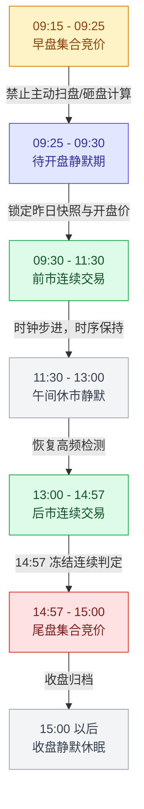
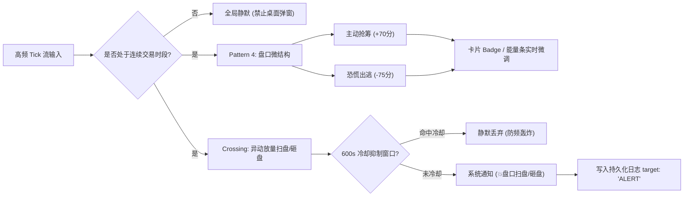

# 爆量扫盘砸盘与微观盘口微结构 (Volume Sweep & Order Flow) 需求与算法规范

> 模块分类：`tape`  
> 适用标的：`个股`  
> 核心标签：`高频异动 | 盘口微结构 | 主动量能流 | 诱空破底翻 | 风险与进攻`  
> 对应代码实现：  
> - 盘口微结构引擎：[patterns.rs](file:///D:/Project/private/ai/ai-finance-moyu/src-tauri/src/trend_engine/patterns.rs#L186-L235)  
> - 趋势分时主分析器：[analyze.rs](file:///D:/Project/private/ai/ai-finance-moyu/src-tauri/src/trend_engine/analyze.rs#L86-L185)  
> - 实时盘口异动放量检测：[anomaly.rs](file:///D:/Project/private/ai/ai-finance-moyu/src-tauri/src/crossing/anomaly.rs#L215-L250)  
> - 异动通知文案与徽标：[format.rs](file:///D:/Project/private/ai/ai-finance-moyu/src-tauri/src/crossing/format.rs#L50-L56)  
> - 盘口五档与内外盘解析：[tencent.rs](file:///D:/Project/private/ai/ai-finance-moyu/src-tauri/src/quote/tencent.rs#L66-L114)、[sina.rs](file:///D:/Project/private/ai/ai-finance-moyu/src-tauri/src/quote/sina.rs#L95-L116)  
> - 下跌归因主力砸盘检测：[fall_attribution.rs](file:///D:/Project/private/ai/ai-finance-moyu/src-tauri/src/trend_engine/fall_attribution.rs#L50-L66)  
> - 盘口微数据模型定义：[quote/types.rs](file:///D:/Project/private/ai/ai-finance-moyu/src-tauri/src/quote/types.rs#L24-L42)、[trend_engine/types.rs](file:///D:/Project/private/ai/ai-finance-moyu/src-tauri/src/trend_engine/types.rs#L35-L40)  
> - 前端微盘口浮层：[MicroTapePopover.tsx](file:///D:/Project/private/ai/ai-finance-moyu/src/components/tape/MicroTapePopover.tsx#L29-L228)、[MicroTapePopover.css](file:///D:/Project/private/ai/ai-finance-moyu/src/components/tape/MicroTapePopover.css#L1-L289)  
> - 前端分时量能副图渲染：[volumeRenderer.ts](file:///D:/Project/private/ai/ai-finance-moyu/src/chart/renderers/volumeRenderer.ts#L32-L196)  
> - 前端实战诊断映射：[stockDiagnosis.ts](file:///D:/Project/private/ai/ai-finance-moyu/src/utils/stockDiagnosis.ts#L45-L53)、[StockBadge.tsx](file:///D:/Project/private/ai/ai-finance-moyu/src/components/StockBadge.tsx#L21-L126)  
> 对应单元测试：  
> - 盘口多空抢筹出逃测试：[flow.rs](file:///D:/Project/private/ai/ai-finance-moyu/src-tauri/src/trend_engine/tests/flow.rs#L8-L34)  
> - 极值破底翻判定测试：[trend_engine/tests/mod.rs](file:///D:/Project/private/ai/ai-finance-moyu/src-tauri/src/trend_engine/tests/mod.rs#L210-L231)  
> - 放量拉升与放量破位测试：[trend_engine/tests/mod.rs](file:///D:/Project/private/ai/ai-finance-moyu/src-tauri/src/trend_engine/tests/mod.rs#L150-L207)  
> - 盘口扫盘砸盘异动测试：[anomaly.rs](file:///D:/Project/private/ai/ai-finance-moyu/src-tauri/src/crossing/tests/anomaly.rs#L226-L285)  
> - 微盘口前端浮层测试：[MicroTapePopover.test.tsx](file:///D:/Project/private/ai/ai-finance-moyu/src/components/tape/MicroTapePopover.test.tsx#L33-L133)  
> - 分时量能渲染测试：[volumeRenderer.test.ts](file:///D:/Project/private/ai/ai-finance-moyu/src/chart/renderers/volumeRenderer.test.ts#L36-L100)  

---

## 1. 业务定位与看盘指引

### 1.1 业务定义与核心意图
- **业务定义**：  
  在微观市场微结构（Microstructure Order Flow）中，盘口价格变动的本质是**限价挂单队列（Limit Order Book, LOB）与市价激进报单（Market/Aggressive Orders）之间的动态撮合碰撞**。普通分时图仅展示成交价格轨迹，往往掩盖了主力资金在微观盘口的真假意图。  
  【爆量扫盘砸盘与微观盘口微结构 (Volume Sweep & Order Flow)】监控系统深入 L1/L5 盘口订单簿与高频成交流底层，通过解析**买卖五档挂单队列失衡度（Bid-Ask Imbalance）**、**主动买卖盘比例（Active Buy Ratio / Outer vs Inner Volume）**、**分时成交量突变速率（Volume Burst Velocity）**以及**均线偏离度（VWAP Bias）**，实时识别以下四大核心微观盘口形态：
  1. **主力主动扫盘攻坚（Aggressive Buying / Volume Sweep）**：主力资金以市价单或激进买单连续吃掉卖方五档阻力挂单，盘口呈现买档深度积压、主动买盘占优且价格强力站上 VWAP 分时均线；
  2. **恐慌资金砸盘出逃（Panic Dumping / Volume Dump）**：大单主动下砸击穿买方多档承接盘，卖方五档巨量压顶，主动卖单（内盘）单边倾泻，驱动价格放量下破均线；
  3. **威科夫破底翻诱空洗盘（Wyckoff Spring Rebound）**：主力在关键分时支撑（VWAP）下方制造“假破位（False Breakdown）”，击穿短线止损盘后迅速引爆主动买盘大单回补，收复失地并展开反弹；
  4. **日内放量拉升与放量破位（Volume Surge & Breakdown）**：结合分钟级动态量比（Local Volume Ratio）与价格斜率，捕捉持续性动量突破与破位风险。

- **看盘痛点与价值**：  
  在摸鱼、桌面常驻小窗或低频盯盘场景下，交易者面临显著的盘口认知壁垒：
  1. **识别假挂单与真成交**：买一挂大单往往是“托单诱多”，随后被瞬间撤销；而系统综合**外盘主动成交占比（$\ge 65\%$）**与**五档失衡度（$\ge +0.45$）**，仅在真金白银主动扫盘时发出“抢筹”确认，杜绝被虚假挂单欺骗；
  2. **防范诱空洗盘被骗下车**：股票分时跌破均线往往诱发散户技术性止损，若属于主力“假摔破底翻（Spring）”，系统在 1~3 分钟内识别主动买单回补特征（能量分高达 $+75$），提示“假摔翻多”，帮助交易者稳住底仓甚至逆势加仓；
  3. **第一时间截断恐慌风险**：当个股脱离板块单边下杀且内盘卖单剧烈砸穿买档时，系统在毫秒级触发“恐慌出逃 / 主力砸盘”预警（能量分 $-75$），严厉告诫“切莫伸手接飞刀”，避免遭遇日内大跌甚至跌停重创。

### 1.2 关键信号解读

| 信号标识 (State) | 核心特征与盘口物理形态 | 操盘指引与含义 | 多空能量分值 | UI微标显示 (Badge) | 实战大白话解读 |
| :--- | :--- | :--- | :--- | :--- | :--- |
| **`AggressiveBuying`**<br>(主动抢筹) | 主动买盘占比 $\ge 65\%$，或五档失衡度 $\ge +0.45$ 且外盘 $>$ 内盘 $\times 1.35$；价格站稳分时均线之上且乖离率 $\ge +0.1\%$。 | **买盘坚决**：多头主力强力攻坚，大单主动扫盘吃尽卖单，动能强势。 | **`+70`** | `⚡ 主动抢筹 · 买盘坚决`<br>紧凑态：`抢筹(强)` | 盘口大单连续主动扫盘吃单，主力做多意图明确，资金博弈强势，顺势跟进。 |
| **`PanicDumping`**<br>(恐慌出逃) | 主动买盘占比 $\le 35\%$ 且 $>0$，或五档失衡度 $\le -0.45$；价格运行于均线下方且负向偏离 $\le -0.35\%$。 | **避险离场**：空头集中抛售，主力大单砸穿买方承接，警惕单边跳水。 | **`-75`** | `▼ 恐慌出逃 · 避险离场`<br>紧凑态：`砸盘(避)` | 大单主动砸盘抛售，恐慌盘与止损盘涌出，切莫盲目伸手接飞刀，果断控险。 |
| **`SpringRebound`**<br>(极值破底翻) | 跌破 VWAP 达 $0.25\%$ 诱空探底后，5分钟内迅速拉回至 VWAP 负乖离 $0.05\%$ 以内，且主动买盘回补（买盘占比 $\ge 58\%$ 或外盘 $>$ 内盘 $\times 1.25$）。 | **假摔翻多**：主力洗盘诱空完成，空头陷阱确认，超跌强力修复。 | **`+75`** | `▲ 破底翻转 · 假摔翻多`<br>紧凑态：`破底翻` | 快速下砸跌破关键支撑后被迅速拉回，空头诱空失败，超跌修复反弹，积极关注。 |
| **`VolumeSurge`**<br>(放量拉升) | 动态量比 $\ge 1.7\times$，价格稳居均线上方，斜率企稳（$\ge -0.05\%$）且较近15分钟低点上涨 $\ge 0.2\%$。 | **顺势看多**：短线爆量脉冲上行，多头买盘推升突破。 | **`+72 ~ +85`**<br>$(55 + 10\times\text{VR})$ | `🔥 放量拉升 · 顺势看多`<br>紧凑态：`放量(多)` | 放量脉冲拉升，多头资金入场扫盘进攻，注意观察分时均线支撑有效性。 |
| **`Breakdown`**<br>(放量破位) | 动态量比 $\ge 1.5\times$，放量跌破分时均线且偏离 $\le -0.3\%$，较近15分钟高点回落 $\ge 0.2\%$。 | **防守止损**：放量击穿关键均线与支撑，形态走弱。 | **`-70`** | `❄️ 放量破位 · 严守止损`<br>紧凑态：`破位(止)` | 放量跌破分时均线与日内支撑位，破位下行风险加剧，严格执行止损纪律。 |
| **`VolumeBurst (Surge)`**<br>(盘口扫盘异动) | 20秒内成交激增 $\ge 300$ 手，1分钟换算速率超日内均速 3 倍，且价格向上推动 $\ge 0.3\%$。 | **脉冲跟进**：盘口瞬间大单集中扫盘突破。 | *(高频事件)* | 桌面通知：`💥盘口扫盘(x.x倍)` | 盘口主买扫盘！放量推升，成交激增，现价拉抬。 |
| **`VolumeBurst (Dump)`**<br>(盘口砸盘异动) | 20秒内成交激增 $\ge 300$ 手，1分钟换算速率超日内均速 3 倍，且价格向下打压 $\ge 0.3\%$。 | **紧急防守**：盘口遭遇突发大单集中抛售。 | *(高频事件)* | 桌面通知：`💥盘口砸盘(x.x倍)` | 盘口主卖砸盘！放量打压，成交激增，现价下挫。 |

### 1.3 UI 呈现与防窥规范
- **宿主组件**：  
  1. **微标组件**：[StockBadge.tsx](file:///D:/Project/private/ai/ai-finance-moyu/src/components/StockBadge.tsx#L21-L126)（外露胶囊微标）与 [StockBadgePopover.tsx](file:///D:/Project/private/ai/ai-finance-moyu/src/components/StockBadgePopover.tsx)（下沉五维穿透诊断卡片）；
  2. **微盘口浮层**：[MicroTapePopover.tsx](file:///D:/Project/private/ai/ai-finance-moyu/src/components/tape/MicroTapePopover.tsx#L29-L228)（常驻钉选与微观买卖能量条）；
  3. **分时量能副图**：[volumeRenderer.ts](file:///D:/Project/private/ai/ai-finance-moyu/src/chart/renderers/volumeRenderer.ts#L32-L196)（红涨绿跌量能柱、竞价双层量柱、线性/平方根阻尼双模式）。

- **图表与视觉规范**：  
  严格遵循 [AGENTS.md](file:///D:/Project/private/ai/ai-finance-moyu/AGENTS.md) 第 15 条「全主题自适应与防窥视觉规范」：
  - **多空微标调性 (Tone)**：
    - `AggressiveBuying` / `SpringRebound` / `VolumeSurge`：绑定多头主题色 `tone="bull"`（暗黑深红底亮红字，浅色柔红底正红字）；
    - `PanicDumping` / `Breakdown`：绑定空头主题色 `tone="bear"`（暗黑深绿底翡翠字，浅色柔绿底深翡翠字）；
  - **微盘口多空红绿对抗能量条 (Tape Energy Bar)**：
    - 位于 `MicroTapePopover` 底部，渲染双段连贯进度条：
      - 买方主动扫盘占比：`style={{ width: `${buyPct}%` }}`，类名 `.tape-bar-segment.buy`；
      - 卖方主动砸盘占比：`style={{ width: `${sellPct}%` }}`，类名 `.tape-bar-segment.sell`；
    - 绝无静态写死色值，变量统一绑定 `var(--trend-up)` 与 `var(--trend-down)`；
  - **分时量柱真实比例渲染**：
    - 连续交易分时量柱遵循红涨绿跌；
    - 集合竞价双层量柱：底部灰色匹配量（`colorAuctionMatched`），顶部未匹配卖单挂于顶格倒挂垂下（`colorDown` 绿色下垂刺），未匹配买单向上堆叠（`colorUp` 红色买盘冲刺）。

- **全主题自适应表现**：  
  - **办公浅色模式 (`data-theme="light"`)**：
    - 阳线与买盘主动：采用高饱满度正红 `#dc2626`（消除发飘淡红）；
    - 阴线与卖盘砸盘：采用深翡翠绿 `#16a34a`（严禁刺眼荧光绿）；
    - 竞价撮合匹配：低饱和灰蓝 `rgba(148, 163, 184, 0.7)`；
    - 浮层背景：`rgba(255, 255, 255, 0.95)` 搭配高斯模糊，文字对比度通过 WCAG AA 认证；
  - **深邃暗黑模式 (`data-theme="dark"`)**：
    - 阳线买盘：`rgba(239, 68, 68, 0.88)`；
    - 阴线卖盘：`rgba(34, 197, 94, 0.88)`；
    - 浮层背景：`var(--surface-popover-bg, rgba(22, 27, 34, 0.95))`。

- **极简防窥要求**：  
  在摸鱼缩小尺寸或紧凑列表态下：
  - 微标收敛为 4 字符精简码：`抢筹(强)`、`砸盘(避)`、`破底翻`、`放量(多)`、`破位(止)`；
  - 配合居中多空能量条（能量分 $-100 \sim +100$），桌面常驻无需展开即可凭余光判断主力资金是在扫盘还是在砸盘；
  - 微盘口浮层具备无感桥接防抖：顶部添加 `::before` 8px 透明隐形桥，鼠标从宿主移入浮层不闪退；支持 `📌 锁定` 常驻与 `ESC` 一键隐藏。

---

## 2. 数学公式与算法细节

### 2.1 依赖基础数据
本指标由微观订单簿快照（L1/L5 `Quote`）与分时时序数据（`TrendPoint`）共同驱动，核心字段定义如下：

| 数据字段 | 来源结构体 | 类型 | 单位/范围 | 业务含义说明 |
| :--- | :--- | :--- | :--- | :--- |
| `quote.bids` | `Quote` | `Vec<(f64, f64)>` | 价格(元), 数量(手) | 买盘一至五档挂单队列，`bids[0]` 为买一，`bids[4]` 为买五。 |
| `quote.asks` | `Quote` | `Vec<(f64, f64)>` | 价格(元), 数量(手) | 卖盘一至五档挂单队列，`asks[0]` 为卖一，`asks[4]` 为卖五。 |
| `quote.outer_vol` | `Quote` | `f64` | 手 (100股) | 外盘累积成交量（以卖方出价成交的主动买入量）。 |
| `quote.inner_vol` | `Quote` | `f64` | 手 (100股) | 内盘累积成交量（以买方出价成交的主动卖出量）。 |
| `quote.bid_ask_imbalance` | `Quote` | `f64` | $[-1.0, +1.0]$ | 盘口买卖五档订单深度失衡度。 |
| `quote.active_buy_ratio` | `Quote` | `f64` | $[0.0, 1.0]$ | 日内主动买盘占比（默认 $0.5$）。 |
| `quote.price` | `Quote` | `f64` | 元 | 实时最新撮合成交价。 |
| `quote.volume` | `Quote` | `f64` | 手 | 日内累积总成交量。 |
| `points[i].avg_price` | `TrendPoint` | `f64` | 元 | 分时加权平均价（分时成交金额 / 分时成交量 / 100），即实时 VWAP 基准。 |
| `points[i].cum_volume`| `TrendPoint` | `f64` | 手 | 截至该分钟的累积成交量。 |

### 2.2 核心数学公式与递推逻辑

#### 2.2.1 买卖五档深度失衡度 (Bid-Ask Imbalance)
计算买方五档总挂单与卖方五档总挂单的相对净差比例：

```math
\text{TotalBids} = \sum_{i=1}^{5} \text{bids}_i.\text{volume}, \quad \text{TotalAsks} = \sum_{i=1}^{5} \text{asks}_i.\text{volume}
```

```math
I_{\text{L5}} = 
\begin{cases}
\text{round}\left( \frac{\text{TotalBids} - \text{TotalAsks}}{\text{TotalBids} + \text{TotalAsks}} \times 1000 \right) / 1000, & \text{TotalBids} + \text{TotalAsks} > 0 \\
0.0, & \text{TotalBids} + \text{TotalAsks} = 0
\end{cases}
```

- **物理意义**：  
  $I_{\text{L5}} \in [-1.0, +1.0]$。  
  - $I_{\text{L5}} \to +1.0$：买盘五档严重积压堆积，买方支撑深厚或主力挂单吸筹；  
  - $I_{\text{L5}} \to -1.0$：卖盘五档重单压顶，卖方抛压沉重；  
  - $I_{\text{L5}} = 0.0$：五档多空势均力敌。

#### 2.2.2 主动买入成交占比 (Active Buy Ratio)
基于日内外盘（主动买量）与内盘（主动卖量）的实际成交总量计算：

```math
R_{\text{active}} = 
\begin{cases}
\text{round}\left( \frac{\text{OuterVol}}{\text{OuterVol} + \text{InnerVol}} \times 1000 \right) / 1000, & \text{OuterVol} + \text{InnerVol} > 0 \\
0.5, & \text{OuterVol} + \text{InnerVol} = 0
\end{cases}
```

- **物理意义**：  
  $R_{\text{active}} \in [0.0, 1.0]$。  
  - $R_{\text{active}} \ge 0.65$：日内成交以资金主动扫盘吃单为主，买方极为坚决；  
  - $R_{\text{active}} \le 0.35$：日内成交以资金主动砸盘砸穿买档为主，空头倾泻抛压。

#### 2.2.3 均线与分时乖离率 (VWAP Bias)
个股分时基准曲线以每分钟累积成交额与累积成交量计算的加权均价 VWAP 为锚：

```math
\text{VWAP}_t = \frac{\text{CumAmount}_t}{\text{CumVolume}_t \times 100}
```

日内分时乖离率定义为现价相对于最新分时均价的百分比偏移：

```math
\text{Bias}_{\%} = \frac{P_t - \text{VWAP}_t}{\text{VWAP}_t} \times 100\%
```

#### 2.2.4 主动抢筹判定式 (Pattern 4: Aggressive Buying)
触发 `TrendState::AggressiveBuying` 必须严格同时满足以下微结构与量价条件：

```math
\begin{cases}
\left( R_{\text{active}} \ge 0.65 \lor \left( I_{\text{L5}} \ge 0.45 \land \text{OuterVol} > \text{InnerVol} \times 1.35 \right) \right) \\
P_t \ge \text{VWAP}_t \\
\text{Bias}_{\%} \ge +0.10\%
\end{cases}
```

- **工程落地**：[patterns.rs L206-L219](file:///D:/Project/private/ai/ai-finance-moyu/src-tauri/src/trend_engine/patterns.rs#L206-L219)
- **多空能量分**：`+70`
- **诊断摘要文案**：  
  `format!("买盘五档深度积压（失衡度 {:.0}%），主动买盘占比 {:.0}%，多头主力强力攻坚", I_L5 * 100.0, R_active * 100.0)`

#### 2.2.5 恐慌出逃判定式 (Pattern 4: Panic Dumping)
触发 `TrendState::PanicDumping` 必须严格同时满足以下微结构抛压条件：

```math
\begin{cases}
\left( \left( R_{\text{active}} \le 0.35 \land R_{\text{active}} > 0.0 \right) \lor I_{\text{L5}} \le -0.45 \right) \\
P_t < \text{VWAP}_t \\
\text{Bias}_{\%} \le -0.35\%
\end{cases}
```

- **工程落地**：[patterns.rs L222-L234](file:///D:/Project/private/ai/ai-finance-moyu/src-tauri/src/trend_engine/patterns.rs#L222-L234)
- **多空能量分**：`-75`
- **诊断摘要文案**：  
  `format!("卖盘五档显著压顶（失衡度 {:.0}%），主动抛压密集砸穿买档，空头恐慌出逃", I_L5 * 100.0)`

#### 2.2.6 威科夫极值破底翻判定式 (Pattern 3: Wyckoff Spring Rebound)
识别分时假摔诱空洗盘并迅速翻多的经典量化形态：

1. **时序样本门禁**：分时序列长度 $N \ge 6$；
2. **主动买盘回补门禁**：
   $$R_{\text{active}} \ge 0.58 \quad \lor \quad \left( \text{OuterVol} > \text{InnerVol} \times 1.25 \ \land \ \text{OuterVol} > 0.0 \right)$$
3. **近 5 分钟极值探底诱空**：  
   取最近 5 分钟切片 $S = [P_{N-5}, \dots, P_{N-1}]$，找出日内局部最低价 $P_{\min} = \min(S)$ 及其对应索引 $k$：
   - 探底深度要求：跌破分时均线超 $0.25\%$
     $$P_{\min} < \text{VWAP}_t \times 0.9975$$
   - 触底后已产生回升拐点：最低点不在最新一根分时柱（$k < |S| - 1$）；
4. **迅速收复关键分水岭**：最新现价回升收复至均线负乖离 $0.05\%$ 以内或站上均线：
   $$P_{\text{latest}} \ge \text{VWAP}_t \times 0.9995$$

```math
\text{SpringConfirmed} = 
\begin{cases}
\text{True}, & \text{满足上述四项条件} \\
\text{False}, & \text{其他}
\end{cases}
```

- **工程落地**：[patterns.rs L186-L200](file:///D:/Project/private/ai/ai-finance-moyu/src-tauri/src/trend_engine/patterns.rs#L186-L200)
- **多空能量分**：`+75`
- **诊断摘要文案**：`"盘中跌破关键支撑后迅速放量收回均线，主动买盘回补，主力洗盘诱空完成"`

#### 2.2.7 高频盘口异动放量扫盘/砸盘 (Real-time Volume Burst)
在连续竞价 Tick 流中（[anomaly.rs L215-L250](file:///D:/Project/private/ai/ai-finance-moyu/src-tauri/src/crossing/anomaly.rs#L215-L250)），若历史样本窗口 $\Delta t \ge 20$ 秒：

```math
\Delta V = \text{Volume}_{\text{now}} - \text{Volume}_{\text{oldest}}
```

```math
\text{Rate}_{1\text{min}} = \frac{\Delta V}{\Delta t} \times 60
```

```math
\text{BaselineAvg} = \max\left( \frac{\max(\text{Volume}_{\text{oldest}}, 200.0)}{\text{ElapsedMinutes}}, 200.0 \right)
```

```math
\text{PriceMotion}_{\%} = \frac{|P_{\text{now}} - P_{\text{oldest}}|}{P_{\text{oldest}}} \times 100\%
```

当满足突发放量三要素：
$$\Delta V \ge 300\text{ 手} \quad \land \quad \text{Rate}_{1\text{min}} \ge 3.0 \times \text{BaselineAvg} \quad \land \quad \text{PriceMotion}_{\%} \ge 0.30\%$$

- 若 $P_{\text{now}} \ge P_{\text{oldest}}$：判定为**盘口主买扫盘**（`is_surge = true`）；
- 若 $P_{\text{now}} < P_{\text{oldest}}$：判定为**盘口主卖砸盘**（`is_surge = false`）。

#### 2.2.8 分时量能副图两档缩放算法 (Volume Subchart Scaling)
由 [volumeRenderer.ts](file:///D:/Project/private/ai/ai-finance-moyu/src/chart/renderers/volumeRenderer.ts#L36-L79) 渲染，消除早盘开盘量刺对日内量柱的压制：

1. **真实比例线性模式 (`linear`, 对齐同花顺)**：  
   剥离 09:15-09:30 集合竞价异常值，严格以日内连续交易分钟最大成交量 $V_{\text{continuous\_max}}$ 为顶格基准：
   $$H_i = \min\left( H_{\text{subplot}}, \max\left( 1, \frac{V_i}{V_{\text{continuous\_max}}} \times H_{\text{subplot}} \right) \right)$$
2. **平方根阻尼模式 (`sqrt`)**：  
   当连续交易分钟柱 $\ge 8$ 根时，计算第 90 分位数 $P_{90}$。若日内最高量刺 $V_{\max} > 2.2 \times P_{90}$，采用 $2.0 \times P_{90}$ 作为有效阻尼顶格线 $C_{\text{eff}}$：
   $$H_i = \min\left( H_{\text{subplot}}, \max\left( 1, \frac{\sqrt{V_i}}{\sqrt{C_{\text{eff}}}} \times H_{\text{subplot}} \right) \right)$$
   对超过顶格阻尼线的极端脉冲，顶部绘制 1px 高光盖帽标线（Spike Cap Marker）。

### 2.3 边界情况与冷启动处理
1. **早盘开盘量刺平滑 (Opening Spike Smoothing)**：  
   在 09:30 产生的第 0 根分钟分时量通常包含早盘集合竞价集中撮合的巨量，若直接代入滚动均量会导致后续量比全部失真。系统在 [analyze.rs L106-L109](file:///D:/Project/private/ai/ai-finance-moyu/src-tauri/src/trend_engine/analyze.rs#L106-L109) 中执行阻尼平滑：
   $$\text{若 } V_0 > 3.0 \times V_1 \text{ 且 } V_1 > 0 \implies V_0 = 2.0 \times V_1$$
2. **五档买卖盘全空保护**：  
   新股上市、极端停牌或竞价未撮合前，$\text{TotalBids} + \text{TotalAsks} = 0$，失衡度输出安全保底值 $0.0$；$\text{OuterVol} + \text{InnerVol} = 0$ 时，主动买盘比例输出中性保底值 $0.5$；
3. **样本不足冷启动**：  
   分时序列长度 $< 6$ 根时，自动阻断 Spring 破底翻判定，防止开盘初期的无序随机波动产生假破底翻误报；
4. **除零与极值防御**：  
   均价 VWAP 计算若出现累积成交量 $\le 0$，安全回退取现价 $P$；所有除法分母添加安全下限 `max(..., 1e-6)`。

---

## 3. 数据契约与时段规则

### 3.1 上游数据链路
- **数据源通道**：  
  遵循 [AGENTS.md](file:///D:/Project/private/ai/ai-finance-moyu/AGENTS.md) 第 1 条规范，行情数据首选腾讯（`qt.gtimg.cn`）与新浪（`hq.sinajs.cn`）单请求多代码拼接接口，严禁直连封禁严重的东财接口。
- **字段供给差异化处理**：  
  - **腾讯接口（首选）**：完整提供五档买卖盘（字段 9~28）、外盘（字段 7）、内盘（字段 8）、委比、量比及均价，为微盘口失衡度与主动买盘占比提供完备的数据源支撑；
  - **新浪接口（降级备选）**：提供五档买卖盘，但未直供内/外盘累积量。在新浪通道下降级计算：$R_{\text{active}}$ 默认置为 $0.5$，失衡度 $I_{\text{L5}}$ 仍正常依据五档队列计算。
- **计算职责划分**：  
  严格遵循“计算收口于 Rust，前端轻量渲染”准则：
  - **Rust 后端**：负责行情解析、五档失衡度推算、VWAP 动态构建、Pattern 模式识别状态机（70/-75分值评定）、高频异动阈值比对及冷却窗口管理；
  - **SolidJS 前端**：仅接收后端强类型 `TrendSignal` 与 `Quote`，执行纯视图层颜色映射、Canvas 量柱绘制与浮层交互。
- **刷新频率**：  
  - 盘中实时 Tick 轮询：标配 3 秒（高频活跃个股自适应）；
  - 分时全量时序轮询：标配 30 秒增量补全；
  - 盘后静默休眠：15:05 后转入低频心跳。

### 3.2 A 股交易时段门禁
严格遵循 [AGENTS.md](file:///D:/Project/private/ai/ai-finance-moyu/AGENTS.md) 第 3 条交易时段划分红线：



1. **`09:15 - 09:25`（早盘竞价）**：  
   由于主力撤单频繁、撮合申报非真实连续成交，**全面禁用**连续交易的 `AggressiveBuying` 与 `PanicDumping` 检测，微盘口显示为“竞价博弈未匹配单”双层量柱；
2. **`09:25 - 09:30`（盘前静默期）**：  
   撮合成交价已定，指标处于只读锁定状态，不接收外盘内盘增量；
3. **`09:30 - 11:30` / `13:00 - 14:57`（连续竞价交易）**：  
   微结构指标全面激活，实时刷新五档失衡度、内外盘比例与异动放量检测；
4. **`14:57 - 15:00`（尾盘集合竞价）**：  
   进入不可撤单尾盘撮合阶段，冻结分钟连续斜率与 VolumeBurst 异动弹窗，锁定收盘前最新盘口信号；
5. **网络容灾与降级**：  
   当网络超时、429 触发熔断时，后端自动冻结状态机并取用本地基准缓存（Baseline Fallback Cache），前端界面保持平滑显示，严禁白屏或抛出异常。

---

## 4. 告警阈值与防扰规范

### 4.1 触发判定规则
系统对微观盘口异动执行分级分流处理，兼顾灵敏度与降噪：



- **绝对阈值门禁**：
  - 主动抢筹绝对门禁：主动买盘占比 $R_{\text{active}} \ge 65\%$，或五档失衡度 $I_{\text{L5}} \ge 0.45$ 且外盘倍数 $> 1.35\times$ 内盘；
  - 恐慌出逃绝对门禁：主动买盘占比 $R_{\text{active}} \le 35\%$，或五档失衡度 $I_{\text{L5}} \le -0.45$；
  - 破底翻绝对门禁：诱空探底深度 $< \text{VWAP} \times 0.9975$，收复高度 $\ge \text{VWAP} \times 0.9995$；
  - 盘口放量异动绝对门禁：20秒增量 $\ge 300$ 手，均速倍数 $\ge 3.0\times$，价格位移 $\ge 0.30\%$。

### 4.2 节流防轰炸与静音机制
严格遵循 [AGENTS.md](file:///D:/Project/private/ai/ai-finance-moyu/AGENTS.md) 第 7 条分级日志与降噪留痕规范：
1. **频次节流冷却锁（Cooldown Window）**：  
   针对突发盘口扫盘/砸盘事件（`VolumeBurst`），系统以 `format!("{code}:vol_burst")` 为键设置 **600 秒（10 分钟）** 的强力冷却时间窗口。在冷却窗口内，即使主力再次爆量扫盘，也仅更新底层数据，严禁重复弹出系统桌面通知；
2. **免打扰守则**：  
   非交易时段与集合竞价阶段一律清空并阻断通知列表，默认禁止任何系统级弹窗轰炸；
3. **日志分级与 Target 规范**：  
   - 盘中爆量异动与破位出逃统一输出到 `target: "ALERT"`：
     `log::info!(target: "ALERT", "[盘中异动] {} ({}): {}", notif.name, notif.code, notif.message);`
   - 恐慌砸盘引发的下跌归因诊断记录：
     `log::info!(target: "ALERT", "[归因诊断] {} ({}): 触发【🚨 主力砸盘】 - {}", q.name, q.code, attr.reason);`
   - 单文件上限 5MB，轮转归档保留最新 3 份，内存环形缓冲区留存 200 条供前端筛选。

---

## 5. 验收基准与测试对齐

### 5.1 黄金测试用例 (Golden Fixture)

#### 用例 A：主动抢筹 (Aggressive Buying) 确认
- **输入特征数据**：
  - 标的代码：`sh600000`（浦发银行）
  - 昨收盘价：$10.00$ 元，现价：$10.03$ 元（涨幅 $+0.30\%$，均价 VWAP：$10.00$ 元，乖离率 $+0.30\% \ge 0.10\%$）
  - 买盘五档：`[(10.03, 3000), (10.02, 2500), (10.01, 1500), (10.00, 1000), (9.99, 1000)]`，$\text{TotalBids} = 9000$ 手
  - 卖盘五档：`[(10.04, 800), (10.05, 600), (10.06, 400), (10.07, 250), (10.08, 200)]`，$\text{TotalAsks} = 2250$ 手
  - 外盘（主动买量）：$5000.0$ 手，内盘（主动卖量）：$2000.0$ 手
- **预期确定性输出**：
  - 五档失衡度：$I_{\text{L5}} = (9000 - 2250) / (9000 + 2250) = 6750 / 11250 = +0.600$
  - 主动买盘占比：$R_{\text{active}} = 5000 / (5000 + 2000) = 5000 / 7000 \approx 0.714$（满足 $\ge 0.65$）
  - 外盘倍数：$5000 > 2000 \times 1.35 = 2700$
  - 触发状态：`TrendState::AggressiveBuying`
  - 紧凑微标：`抢筹`
  - 多空能量分值：`+70`
  - 诊断说明：包含 `"买盘五档深度积压（失衡度 60%），主动买盘占比 70%，多头主力强力攻坚"`

#### 用例 B：恐慌出逃 (Panic Dumping) 确认
- **输入特征数据**：
  - 标的代码：`sh600000`
  - 昨收盘价：$10.00$ 元，现价：$9.92$ 元（跌幅 $-0.80\%$，均价 VWAP：$10.00$ 元，乖离率 $-0.80\% \le -0.35\%$）
  - 买盘五档总计：$1750$ 手，卖盘五档总计：$8250$ 手
  - 外盘：$2800.0$ 手，内盘：$7200.0$ 手
- **预期确定性输出**：
  - 五档失衡度：$I_{\text{L5}} = (1750 - 8250) / (1750 + 8250) = -6500 / 10000 = -0.650$（满足 $\le -0.45$）
  - 主动买盘占比：$R_{\text{active}} = 2800 / 10000 = 0.280$（满足 $\le 0.35$）
  - 触发状态：`TrendState::PanicDumping`
  - 紧凑微标：`出逃`
  - 多空能量分值：`-75`
  - 诊断说明：包含 `"卖盘五档显著压顶（失衡度 -65%），主动抛压密集砸穿买档，空头恐慌出逃"`

#### 用例 C：威科夫假摔极值破底翻 (Spring Rebound) 确认
- **输入特征数据**：
  - 标的代码：`sh600000`，均价 VWAP 基准：$10.00$ 元
  - 前 10 分钟均价与现价平稳维持在 $10.00$ 元
  - 第 11~14 分钟快速下探：$9.97 \to 9.94 \to 9.98 \to 10.00$
  - 局部最低点 $P_{\min} = 9.94$ 元（$9.94 < 10.00 \times 0.9975 = 9.975$ 元，诱空跌破关键均线达 $-0.60\%$）
  - 最新价格 $P_{\text{latest}} = 10.00$ 元（$10.00 \ge 10.00 \times 0.9995 = 9.995$ 元，迅速反包收复均线）
  - 主动买盘占比：$R_{\text{active}} = 0.65$（外盘 $3000$ 手，内盘 $1500$ 手，满足外盘 $> 1.25\times$ 内盘）
- **预期确定性输出**：
  - 触发状态：`TrendState::SpringRebound`
  - 紧凑微标：`破底翻`
  - 多空能量分值：`+75`
  - 诊断说明：`"盘中跌破关键支撑后迅速放量收回均线，主动买盘回补，主力洗盘诱空完成"`

#### 用例 D：盘口异动放量扫盘 (Volume Burst) 确认
- **输入特征数据**：
  - $t_0$ 初始样本：价格 $10.00$ 元，成交量 $1000$ 手
  - $t_0 + 25\text{s}$ 最新快照：价格 $10.10$ 元，成交量 $50000$ 手（$\Delta V = 49000$ 手 $\ge 300$ 手）
  - 价格位移：$+1.00\% \ge 0.30\%$，放量倍数 $\ge 3.0\times$
- **预期确定性输出**：
  - 触发事件：`CrossingEvent::VolumeBurst`（`is_surge = true`）
  - 徽标文字：`💥盘口扫盘(x.x倍)`
  - 系统通知文案：包含 `"💥 盘口主买扫盘！放量推升 +1.00% (日内 +1.00%)"`

### 5.2 代码与测试映射 (Traceability Matrix)

| 功能模块与算法节点 | 责任代码文件 | 精确代码行号 | 关联单元测试文件与用例 |
| :--- | :--- | :--- | :--- |
| **主动抢筹与恐慌出逃判定** | [patterns.rs](file:///D:/Project/private/ai/ai-finance-moyu/src-tauri/src/trend_engine/patterns.rs) | [L203-L235](file:///D:/Project/private/ai/ai-finance-moyu/src-tauri/src/trend_engine/patterns.rs#L203-L235) | [flow.rs#L8-L34](file:///D:/Project/private/ai/ai-finance-moyu/src-tauri/src/trend_engine/tests/flow.rs#L8-L34) (`detects_aggressive_buying_and_panic_dumping`) |
| **威科夫假摔极值破底翻** | [patterns.rs](file:///D:/Project/private/ai/ai-finance-moyu/src-tauri/src/trend_engine/patterns.rs) | [L186-L200](file:///D:/Project/private/ai/ai-finance-moyu/src-tauri/src/trend_engine/patterns.rs#L186-L200) | [trend_engine/tests/mod.rs#L210-L231](file:///D:/Project/private/ai/ai-finance-moyu/src-tauri/src/trend_engine/tests/mod.rs#L210-L231) (`detects_spring_rebound`) |
| **放量拉升与放量破位** | [patterns.rs](file:///D:/Project/private/ai/ai-finance-moyu/src-tauri/src/trend_engine/patterns.rs) | [L261-L281](file:///D:/Project/private/ai/ai-finance-moyu/src-tauri/src/trend_engine/patterns.rs#L261-L281) | [trend_engine/tests/mod.rs#L150-L207](file:///D:/Project/private/ai/ai-finance-moyu/src-tauri/src/trend_engine/tests/mod.rs#L150-L207) (`detects_volume_surge`, `detects_breakdown`) |
| **腾讯五档与内外盘算法** | [tencent.rs](file:///D:/Project/private/ai/ai-finance-moyu/src-tauri/src/quote/tencent.rs) | [L101-L114](file:///D:/Project/private/ai/ai-finance-moyu/src-tauri/src/quote/tencent.rs#L101-L114) | [quote/tests/mod.rs#L40-L60](file:///D:/Project/private/ai/ai-finance-moyu/src-tauri/src/quote/tests/mod.rs#L40-L60) |
| **新浪五档与失衡度算法** | [sina.rs](file:///D:/Project/private/ai/ai-finance-moyu/src-tauri/src/quote/sina.rs) | [L104-L114](file:///D:/Project/private/ai/ai-finance-moyu/src-tauri/src/quote/sina.rs#L104-L114) | [sina_tests.rs#L20-L35](file:///D:/Project/private/ai/ai-finance-moyu/src-tauri/src/quote/tests/sina_tests.rs#L20-L35) |
| **高频异动放量扫盘/砸盘** | [anomaly.rs](file:///D:/Project/private/ai/ai-finance-moyu/src-tauri/src/crossing/anomaly.rs) | [L215-L250](file:///D:/Project/private/ai/ai-finance-moyu/src-tauri/src/crossing/anomaly.rs#L215-L250) | [crossing/tests/anomaly.rs#L226-L285](file:///D:/Project/private/ai/ai-finance-moyu/src-tauri/src/crossing/tests/anomaly.rs#L226-L285) (`volume_burst_distinguishes_...`) |
| **下跌归因主力砸盘检测** | [fall_attribution.rs](file:///D:/Project/private/ai/ai-finance-moyu/src-tauri/src/trend_engine/fall_attribution.rs) | [L50-L66](file:///D:/Project/private/ai/ai-finance-moyu/src-tauri/src/trend_engine/fall_attribution.rs#L50-L66) | [trends.rs#L155-L176](file:///D:/Project/private/ai/ai-finance-moyu/src-tauri/src/poller/trends.rs#L155-L176) |
| **前端微盘口能量条浮层** | [MicroTapePopover.tsx](file:///D:/Project/private/ai/ai-finance-moyu/src/components/tape/MicroTapePopover.tsx) | [L43-L57](file:///D:/Project/private/ai/ai-finance-moyu/src/components/tape/MicroTapePopover.tsx#L43-L57), [L209-L220](file:///D:/Project/private/ai/ai-finance-moyu/src/components/tape/MicroTapePopover.tsx#L209-L220) | [MicroTapePopover.test.tsx#L33-L62](file:///D:/Project/private/ai/ai-finance-moyu/src/components/tape/MicroTapePopover.test.tsx#L33-L62) |
| **分时量能副图渲染引擎** | [volumeRenderer.ts](file:///D:/Project/private/ai/ai-finance-moyu/src/chart/renderers/volumeRenderer.ts) | [L36-L162](file:///D:/Project/private/ai/ai-finance-moyu/src/chart/renderers/volumeRenderer.ts#L36-L162) | [volumeRenderer.test.ts#L36-L100](file:///D:/Project/private/ai/ai-finance-moyu/src/chart/renderers/volumeRenderer.test.ts#L36-L100) |
| **实战操盘穿透诊断引擎** | [stockDiagnosis.ts](file:///D:/Project/private/ai/ai-finance-moyu/src/utils/stockDiagnosis.ts) | [L45-L53](file:///D:/Project/private/ai/ai-finance-moyu/src/utils/stockDiagnosis.ts#L45-L53), [L91-L110](file:///D:/Project/private/ai/ai-finance-moyu/src/utils/stockDiagnosis.ts#L91-L110) | [StockBadge.tsx#L21-L126](file:///D:/Project/private/ai/ai-finance-moyu/src/components/StockBadge.tsx#L21-L126) |
